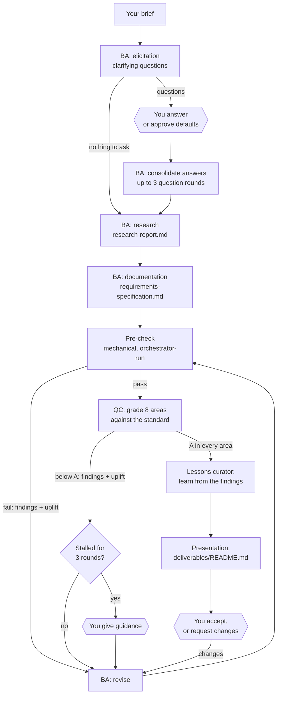

# BusinessAnalysisTeam

An AI business analysis team. A **Business Analyst** agent gathers requirements, researches the domain and
writes the documentation. A separate **Quality Controller** agent then grades it against a written
standard. **The passing grade is A.** Anything lower goes back to the analyst with every finding and the
exact change needed to reach A. The loop repeats until QC can objectively award A in every area, and only
then is the documentation presented to you.

It is the business-analysis part of [AgentTeam](https://github.com/AndrewWhitfield/AgentTeam), built as a
standalone project. It is TypeScript on the [Claude Agent SDK](https://code.claude.com/docs/en/agent-sdk).
It keeps AgentTeam's load-bearing rules: no agent grades its own work, quality gates are measured rather
than opinion, the outcome comes before cost, and the team learns from every finding and every piece of
your feedback.

This README is the design document. Keep it as the single source of truth: amend it in place and record
changes in the [Revision log](#revision-log).

## Contents

- [How it works](#how-it-works)
- [What an A grade is](#what-an-a-grade-is)
- [The team](#the-team)
- [Quality gates](#quality-gates)
- [What you get](#what-you-get)
- [Using it](#using-it)
- [Continuous learning](#continuous-learning)
- [Cost and budget](#cost-and-budget)
- [Design decisions](#design-decisions)
- [Repository layout](#repository-layout)
- [Revision log](#revision-log)

## How it works



Most of the work runs without you. You come in at three points, each of which pauses the run:

1. **Questions.** Answer the analyst's clarifying questions, or approve the default assumptions it
   states for each one.
2. **Guidance.** This happens only if QC rounds stop improving. It usually means the analyst needs a
   fact or a decision that only you can give.
3. **Acceptance.** Read the A-graded pack. Accept it, or request changes. A change goes back through
   the same gate to A.

## What an A grade is

The full definition is [standards/grading-standard.md](standards/grading-standard.md). Both agents' prompts
embed it, and the orchestrator computes grades by its rules. It is the only place the bar is defined.

**A** means a senior business analyst and a demanding reviewer at a strong consultancy would release
the pack to stakeholders for sign-off **without changes**. At most, optional polish remains.

The standard makes this objective in four ways.

1. **Findings, not impressions.** Every finding gives its location, the problem, the evidence, and an
   **Uplift:** line: the exact change that brings it to A standard. A finding without an uplift
   invalidates QC's report.
2. **Severities with fixed definitions:**

   | Severity | Meaning |
   |---|---|
   | CRITICAL | Would lead a stakeholder to a wrong decision |
   | MAJOR | A reviewer would block sign-off |
   | MINOR | Must be fixed, but changes nothing a reader would decide |
   | OBSERVATION | Optional polish |

3. **The grade is computed from the severities, never chosen.**

   | Grade | Rule |
   |---|---|
   | A | No CRITICAL, MAJOR or MINOR findings, plus recorded evidence that each A criterion holds |
   | B | MINOR findings only |
   | C | One or two MAJOR |
   | D | One CRITICAL, or three or more MAJOR |
   | E | Two or more CRITICAL, or the area is unusable |

   QC states a grade, and the orchestrator recomputes it from the findings. If the two differ, QC's
   report is invalid and goes back to QC.
4. **Eight areas, each with explicit A criteria.** The overall grade is the lowest area grade, with no
   averaging. One MINOR finding anywhere makes the pack a B.

| Area | A means |
|---|---|
| Completeness | Every template section is present. Every brief need and owner answer is addressed. NFRs cover security, performance, availability, accessibility and compliance. |
| Accuracy | Every factual claim cites a source. QC fetches at least five sources, including every one behind a key finding, and each supports its citation. Nothing is fabricated or falsely precise. |
| Research | Every research question is answered. Each key finding has two or more independent, credible, current sources. Alternatives, including "do nothing", are examined. Counter-evidence and the regulatory context are covered. |
| Requirements | Each requirement meets ISO/IEC/IEEE 29148: singular, unambiguous, feasible and verifiable. Each has an ID, a MoSCoW priority, a rationale, a source and measurable acceptance criteria. No vague terms. |
| Traceability | Every requirement traces back to the brief, an owner answer or a source, and forward to its acceptance criteria. Every need traces to a requirement or to a scope-out. |
| Consistency | No contradictions. Terminology follows the glossary. IDs are unique and resolve. The research and the specification agree. |
| Alignment | The pack is what you asked for. Anything beyond the brief is flagged as a recommendation. Every assumption is marked "to be validated", with who validates it. |
| Clarity | The executive summary stands alone. The structure follows the templates. Language is plain, and every term is defined. |

Facts that only you can supply, such as budgets, internal policies or names, don't block an A once
they are handled properly. They become explicit assumptions or open questions, each naming who
resolves it. Inventing them is a defect.

## The team

| Role | Purpose | Key inputs | Key outputs | Tools |
|---|---|---|---|---|
| **Business Analyst** | Elicit requirements, research thoroughly, document to A standard, fix every finding | Brief, owner answers, QC findings with uplift, owner guidance | `elicitation/questions-round-n.md`, `elicitation/elicitation-record.md`, `deliverables/research-report.md`, `deliverables/requirements-specification.md` | Read, Write and Edit (its own files only, enforced by a hook), Glob, Grep, WebSearch, WebFetch |
| **Quality Controller** | The independent quality gate. Grades the pack against the standard and challenges its accuracy and quality | Brief, owner answers, both deliverables, its previous report, the BA's reply | A graded `qc-report`: per-area findings, uplift and A evidence | Read, Glob, Grep, WebSearch, WebFetch. Read-only, enforced by a hook. |
| **Lessons curator** | Turn your feedback, and the findings QC had to raise, into general lessons so they aren't repeated | Your words, or the QC and pre-check history of an analysis, plus the lesson ledger | `knowledge/lessons.json` updates | None (text only) |
| **Orchestrator** (code, not an agent) | Run the state machine, the pre-check, grade computation, stall detection, budget, records, presentation | Run status | Checkpoints, review files, presentation page, commits | n/a |

All three agents default to `claude-opus-5-5`: the BA and QC at `xhigh` effort, the curator at `high`. You
can override any of them with `BAT_MODEL_<ROLE>` and `BAT_EFFORT_<ROLE>`.

**No self-grading.** The BA never grades its own work. QC can't edit the pack. The pre-check and the
grade computation are orchestrator code that no agent can change. The BA may dispute a finding with
evidence in its handoff, and QC then sees that reply and must either uphold the finding with stronger
evidence or withdraw it.

## Quality gates

| Gate | Pass condition | Tooling |
|---|---|---|
| **Pre-check** (mechanical) | Both deliverables exist and have every template section, each non-empty. No placeholders (TBD, TODO, …). At least `--min-sources` registered sources (default 5) from at least 3 publishers, each with a URL or marked owner-provided. Every `[S#]` citation resolves, and every registered source is cited. Requirement tables have six columns, a unique ID, a source citation, a MoSCoW priority and acceptance criteria. No vague terms without a number. Every BR/FR/NFR appears in the traceability matrix, and every referenced ID is defined. | `src/quality/precheck.ts`. Runs before QC so QC's judgement isn't spent on what a tool can count. Run it by hand with `npm run pack-check -- <project>`. |
| **QC grade** | QC's report is valid and every one of the eight areas computes to A | QC agent, then `src/quality/qcReport.ts` |
| **Report validity** (QC's own gate) | All eight areas are present, each graded once. Every non-observation finding has its uplift. Every area has A evidence. Each stated grade matches the computed one. | `evaluateQcReport`. An invalid report goes back to QC, not to the BA. After three invalid reports in a row, you're asked. |

**Stall rule.** There is no round cap that lets a lower grade through. The orchestrator scores each round
(area grades, less a point per finding, so fixing findings within a grade counts as progress). If three
consecutive rounds fail to beat the best earlier round, the run stops and asks you for guidance.
Usually the analyst needs something only you know. Your guidance resets the count.

## What you get

Each analysis is its own folder and local git repo, under `BAT_ANALYSES_ROOT` (default
`C:\DEV\Repos\Analyses`). The orchestrator commits there after every step and never pushes.

```
<analysis>/
  brief.md                          your brief, verbatim
  inputs/                           (optional) files you add for the analyst to read
  elicitation/
    questions-round-1.md            the analyst's questions: why each matters, the default if unanswered
    answers-round-1.md              your answers, verbatim
    elicitation-record.md           every question with its answer or the assumption adopted
  deliverables/
    README.md                       START HERE: status, executive summary, decisions needed, QC certificate, round history
    research-report.md              findings, comparables, regulatory context, counter-evidence, source register
    requirements-specification.md   objectives, stakeholders, scope, BR/FR/NFR with acceptance criteria, data, rules,
                                    assumptions, constraints, dependencies, risks, open questions, traceability, glossary
  reviews/
    round-n-precheck.md             each pre-check result
    round-n-qc.md                   each QC report (the last one is the QC certificate)
  .ba/                              run status, checkpoint, budget, every agent handoff
```

The document structures are fixed by
[standards/requirements-specification-template.md](standards/requirements-specification-template.md) and
[standards/research-report-template.md](standards/research-report-template.md).

## Using it

### Setup

```bash
npm install
```

Copy `.env.example` to `.env` and set `ANTHROPIC_API_KEY`. Other settings are optional.

### Start an analysis

Write your brief in a file (see [examples/brief-example.md](examples/brief-example.md)), then run:

```bash
npm start -- --project room-booking --brief-file my-brief.md
```

Flags:

- `--no-questions` skips elicitation.
- `--min-sources <n>` sets the pre-check's source minimum (default 5).

To give the analyst supporting documents, put them in `<analysis>/inputs/` and mention them in the brief.

### Answer, guide, accept

The run stops at each checkpoint and writes it to `<analysis>/.ba/checkpoint.md`.

To answer, give guidance or request changes, write your text in a file and run:

```bash
npm start -- --project room-booking --resume --feedback-file my-answers.md
```

To approve the default assumptions, continue a stalled loop as is, accept the pack, or continue past a
budget pause, run:

```bash
npm start -- --project room-booking --resume --approve
```

Use the `-file` forms for anything longer than one line. On Windows, `npm` passes arguments through
cmd.exe, which silently cuts text at its first line break.

### Other commands

| Command | What it does |
|---|---|
| `npm run learn -- --project <name> --occasion "<what>" --file <path>` | Teaches the team from feedback given outside a run |
| `npm run pack-check -- <project>` | Runs the mechanical pre-check by hand |
| `npm run check` | Typecheck, lint (complexity cap 12) and the test suite |

## Continuous learning

The team learns from every analysis, and what it learns lives in `knowledge/`, committed to this repo:

| File | What it holds |
|---|---|
| `owner-feedback.jsonl` | Every answer, guidance and change request you give, verbatim |
| `qc-findings.jsonl` | Every finding QC raised, with its uplift |
| `lessons.json` | The curated lessons. Every BA and QC session carries the active lessons for its role. |

The Lessons curator runs twice:

- **after your input**, generalising it so you never have to say it twice;
- **once a pack reaches A after more than one round**, turning the findings QC had to raise into
  lessons for the analyst, so the next first draft starts closer to A.

The curator merges duplicates and retires lessons that turn out to be wrong, and caps each role's
lessons at 30. The orchestrator commits `knowledge/` with a pathspec commit and never pushes.

## Cost and budget

Outcome comes before cost: the defaults use the strongest model at high effort, and no quality
threshold is ever relaxed to save money. Cost is still tracked and reported honestly.

- **Spend is real.** Each agent call's cost comes from the SDK result. It is recorded in `.ba/budget.json`
  and shown after every step and on the presentation page.
- **Capped per invocation.** `BAT_MAX_RUN_USD` defaults to $30. Each call's SDK `maxBudgetUsd` is set to
  what's left, and a call isn't started with less than $2 remaining. At the cap the run stops at a
  `budget` checkpoint, and `--resume --approve` continues with a fresh cap.
- **Expected spend** (an estimate, not yet measured on a live run): elicitation under $2; research and
  documentation $3–10, depending on depth; each QC round $2–5 and each revision $1–4. A typical analysis
  reaching A in two to four rounds costs roughly $10–35. The first live runs should replace this
  estimate with measured figures.
- **Cost-saving design:**
  - the free mechanical pre-check runs before QC;
  - an invalid QC report is repaired by QC alone, not by a BA revision;
  - the stall rule stops rounds that can't converge;
  - a malformed handoff gets one short corrective retry rather than a redo.

## Design decisions

- **Derived from AgentTeam, not forked.** AgentTeam is a software-delivery team. This project keeps
  its business-analysis roles (Requirements analyst, Creative analyst, Strategy reviewer) and its
  machinery (scoped SDK sessions, handoff schema, tool-policy hooks, graded gate, owner checkpoints,
  lessons ledger, budget caps). It merges them into two focused roles with a documentation-specific
  standard. It starts with fresh history, so no AgentTeam project records are published here.
- **The grade is computed.** AgentTeam's code reviewer states an A–E letter per area. Here the letter
  follows mechanically from severity-classified findings. That is what makes the A objective and
  auditable.
- **Uplift is mandatory.** Below A, the BA receives every finding together with how to reach A, worst
  first, in one revision round.
- **Deterministic orchestration.** Each step is one scoped `query()` call driven by code, not by an
  agent dispatching subagents. Gates, loops, budgets and resumability are guaranteed in code.
- **Isolated sessions.** Agents run with no user or project settings, no MCP servers and no claude.ai
  connectors. They work in the analysis folder, and hooks confine their writes.

## Repository layout

```
standards/        grading-standard.md (the A definition) and the two document templates
src/agents/       Business Analyst, Quality Controller, Lessons curator; SDK invoke, models, tool policies
src/quality/      grading rules, QC report parser, mechanical pre-check, stall detection
src/orchestrator/ the state machine (pipeline.ts), records, learning ledger, presentation page
knowledge/        what the team has learnt (committed)
test/             unit tests, plus an end-to-end pipeline test with scripted agents (no model spend)
examples/         an example brief
```

## Revision log

- **2026-10-10.** Created from AgentTeam's business-analysis roles at the owner's request. Business
  Analyst and Quality Controller with an A-only gate; the grading standard (the definition of A); the
  mechanical pre-check; stall-based owner escalation; continuous learning from owner feedback and QC
  findings. The pipeline is proven end to end with scripted agents (47 tests). A live run with real
  agents is still to come.
