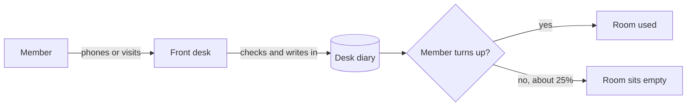
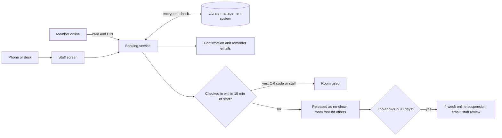
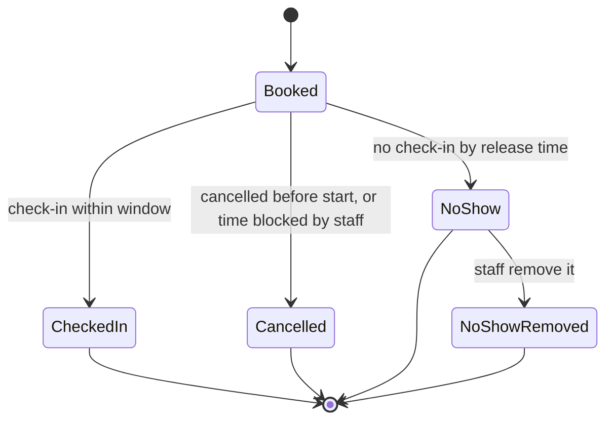

# Requirements specification — Online study-room booking for the town library

## 1. Document control

| Item | Detail |
|---|---|
| Version | 0.5 |
| Date | 10 October 2026 |
| Status | Draft for Quality Controller review (becomes "QC-approved draft for owner sign-off" once graded A) |
| Author | Business Analyst agent |
| Reviewer | Quality Controller agent |
| Sign-off | Library service manager (owner). Approvers: council IT, the data protection officer (DPO) and the council's procurement team [A:Q-13] |
| Inputs | `brief.md`; `elicitation/answers-round-1.md`; `elicitation/elicitation-record.md`; `deliverables/research-report.md` (revised version of 10 October 2026, sources S1–S90) |

**Change history**

| Version | Date | Change | By |
|---|---|---|---|
| 0.1 | 10 October 2026 | First draft. Turns the brief, the 15 owner-approved round-1 defaults, the 23 unasked defaults (AS-01 to AS-23) and the research conclusions (C-1 to C-17) into 89 requirements. | Business Analyst agent |
| 0.2 | 10 October 2026 | Revision after QC round 1 (15 findings). **Added:** NFR-26 (limit on failed member sign-ins), with AS-34, AS-35 and RSK-15 (research F-34, C-18); FR-50 (message when the LMS can't be reached, split from FR-6); FR-48 split into FR-48, FR-51 and FR-52 (door screen); BR-16 (LMS supplier invited to quote for a booking module, from Q-8). Now 94 requirements. **Changed:** no-show estimate corrected to 14–17%, and the role of release restated (it recovers room time but doesn't lower the no-show rate) in §2, §3, BR-2, RSK-1 and OQ-2; FR-32 covers changed bookings, and FR-17's and FR-18's criteria no longer test email; NFR-9's data list matches §11, including notification, audit and failed sign-in records; NFR-14 asks for a service credit; AS-07 reworded to match FR-15; the Must pass/fail rule limited to supplier-facing requirements (§1, §8, CON-5); the Data Protection Act 2018 added to CON-12; §13.1 and §18 forward traces rebuilt as the exact inverse of the Source columns, with [A:Q-2] added to FR-23 and FR-33, [S3] to BRL-21, and assumption tags to FR-1, FR-12, FR-34, FR-36, FR-40 and NFR-9; FR, US and service credit added to the glossary. **Research report:** F-4, F-6, F-7, F-9, F-12, F-14, F-27, F-28 and F-33 corrected or extended; S37, S51 and S76 corrected; S77 to S85 added. | Business Analyst agent |
| 0.3 | 10 October 2026 | Revision after QC round 2 (1 major, 1 minor finding). **Sign-in limit given an overall cap:** NFR-26 now works in two stages: a block of at least 15 minutes after every 5 consecutive failures, then, at 20 failures counted across blocks, no online sign-in for the card until staff re-enable it. Its criteria now test the cap, the reset and the staff re-enable. NIST's 100 is restated as a cap at which sign-in is disabled, not a rate, in AS-34, research F-34 and C-18. FR-43 gives front-desk staff the re-enable action, with [S76] added to its source. FR-31's log includes re-enables. AS-35 also asks for the PIN's length and puts the cap below any LMS lock. RSK-15, NFR-9, §11 (failed sign-in record), §2 and the §13.1 and §18 rows were updated to match. **Added:** NFR-27 (Should: a bot check when sign-ins for many card numbers fail from one network address), with AS-36, from QC's optional observation and research F-34. Now 95 requirements (77 Must, 13 Should, 5 Could). **Door-screen check-in made consistent:** BRL-17 and AS-24 now check in a "book now" booking made on the door screen (FR-52) at once, as FR-52 says, and FR-52's source cites AS-24. **Also:** §6.3 states what happens to REC-1 to REC-4 if the owner doesn't decide. **Research report:** §1 shortened; F-34 quotes NIST's "by disabling that authenticator" and the NCSC's "progressively increasing time delay", and adds OWASP guidance; §7, R-14, §9 and C-18 updated; S86 and S87 added. | Business Analyst agent |
| 0.4 | 10 October 2026 | Revision after QC round 3 (2 minor findings). **PIN-guessing estimate corrected:** AS-34 no longer assumes random PINs (0.2%). It now says 20 guesses would find roughly 5–8% of 4-digit PINs that members chose themselves (an estimate from a peer-reviewed study of user-chosen PINs, S88), that council IT should weigh this when validating 20, and that NIST allows any cap of 100 or less. AS-35 now also asks how PINs are set (chosen by members, a default such as the date of birth, or with common PINs refused), because that matters more than their length (S88, S89, S90). §2, RSK-15 and the stakeholder and decision lists were updated to match. **One term per concept:** the stage-1 period of the sign-in limit, called a "block" in version 0.3 (see its entry above), is now a "sign-in pause" in §2, NFR-26 (statement, rationale and all criteria), AS-34, RSK-15 and the glossary. "Block" now means only a period in which staff make a room unavailable (FR-39). The LMS account status is now "LMS block" (FR-7, BRL-1, §13.1 Q-3 and the glossary), and FR-43's action reads "re-enable online sign-in for a card stopped at the overall cap". NFR-26 criterion (d) now tests "more than 15 minutes after the 20th failure". Generic uses of "block" were reworded (FR-35, NFR-27, RSK-15, OQ-1, OQ-2). Glossary entries added: LMS block, sign-in limit, sign-in pause. No requirement was added or removed; still 95 (77 Must, 13 Should, 5 Could). **Research report:** F-34 adds evidence on how PINs are chosen; §1, §4, §9, R-14 and C-18 updated; "sign-in pause" used throughout; F-14 says SIM Resource Booking's listing gives no price for the service; §1 shortened; S88 to S90 added. | Business Analyst agent |
| 0.5 | 10 October 2026 | Revision after QC round 4 (1 minor finding, 2 optional observations). **NIST counter-evidence reported:** the pack no longer says the sign-in limit "meets NIST". NIST SP 800-63B-4 calls a numeric password a PIN and requires a password used as the only factor to be at least 15 characters (§3.1.1, §3.1.1.2) [S76], so a library PIN falls short of NIST whatever the cap. AS-34 now says that any cap of 100 or less meets NIST's limit on failed attempts (§3.2.2), and that council IT notes the 15-character shortfall and accepts the remaining risk when it validates 20. The cap of 20 is now described as "within both limits" in NFR-26 (whose rationale also states the shortfall) and in research C-18. Card and PIN stays as the owner-approved default [A:Q-8]; no requirement, priority or value changed and no owner question was added; still 95 requirements (77 Must, 13 Should, 5 Could). §2 (council IT's decision) and RSK-15 (mitigation) were updated to match. **Optional observations taken:** RSK-15 now says a stranger gets at most 20 guesses before staff must re-enable online sign-in for the card, not 20 per card; the AS-34 basis and AS-35 were shortened to their key figures and now point to research F-34 for the argument. **Research report:** F-34's NIST bullet, §7 NIST row, R-14, §9 (new limitation) and C-18 report the 15-character rule; "meets it" in C-18 became "is within both that limit and OWASP's"; §1 decisions updated; S76's register entry adds §3.1.1 and §3.1.1.2 (re-verified 10 October 2026); C-18 now also rests on F-16. | Business Analyst agent |

**How to read this document**
- Sources: `[Brief]` is the owner's brief; `[A:Q-n]` is the owner-approved default for round-1 question Q-n; `[S#]` is a source in the research report's register (§11). `AS-nn` is an assumption in §13 and keeps the two-digit number used in the elicitation record and research report. `F-n`, `R-n` and `C-n` are findings, risks and conclusions in the research report.
- Priorities follow MoSCoW: **Must** (essential; each supplier-facing Must, meaning each FR or NFR Must and CON-8, is pass or fail when suppliers are evaluated, CON-5; BR Musts are the library's or council's own outcomes and tasks, verified as §18 shows), **Should** (important, compared between suppliers), **Could** (desirable if affordable, priced separately), **Won't** (not this time).
- Acceptance criteria use Given/When/Then, or a metric with a target and a measurement method. "Core journeys" are defined in the glossary (§19).
- Where this document and the elicitation record differ, this document takes precedence and says why (elicitation record §2). Requirements added in version 0.2 (BR-16, FR-50 to FR-52, NFR-26) and version 0.3 (NFR-27) take the next free number and sit with their topic.

## 2. Executive summary

**Problem.** Members book the library's six study rooms by phone or at the front desk. At exam time the desk is overwhelmed, and around a quarter of booked rooms sit empty because people don't turn up [Brief]. The library has about 4,000 active members and about 300 bookings a month, peaking in May and December [Brief].

**Objectives** (§4). OBJ-1: no-shows at or below 12% in May 2027, from about 25% today. OBJ-2: at least 60% of bookings made by members themselves. OBJ-3: live by 1 March 2027. OBJ-4: meet the public-sector accessibility rules at go-live [Brief]. The targets and date are the owner's approved defaults [A:Q-1][A:Q-6].

**Recommendation.** Buy a hosted booking product made for libraries and configure it, rather than build one; keep phone and desk booking in the same calendar; and fight no-shows with three measures together: reminders with an easy cancel link, check-in with automatic release, and suspension after repeated no-shows, with notice and staff review (research C-1 to C-3). Trade-off: a yearly subscription and reliance on the library-system supplier for a secure sign-in link, in exchange for a faster, lower-risk launch before the May 2027 peak.

**Most important requirements** (77 Musts, 13 Shoulds, 5 Coulds).
- Members see free rooms and book themselves, signing in with their library card number and personal identification number (PIN), checked live against the library management system over an encrypted link. Wrong PINs are limited in two stages: a sign-in pause of at least 15 minutes after every 5, and after 20 no online sign-in until staff re-enable it (BR-1, FR-1, FR-5, FR-6, NFR-2, NFR-26).
- One calendar for online, phone, desk and walk-in bookings, with no double booking (BR-4, FR-10, FR-12, FR-17).
- Booking rules (1-hour slots, at most 3 hours, 14 days ahead, 2 future bookings) with a stricter peak set, changeable by staff (BRL-8 to BRL-13, FR-40, FR-41).
- Email confirmation and day-before reminder; check-in by QR (quick response) code or through staff; release 15 minutes after the start; 4-week online suspension after 3 no-shows in 90 days, with emails and staff correction (FR-23 to FR-30, FR-32, FR-33).
- Reports that measure the targets (FR-45, FR-46).
- Web Content Accessibility Guidelines (WCAG) 2.2 level AA for member and staff pages; hosting in the UK or a country covered by UK adequacy regulations; Cyber Essentials certification; multi-factor sign-in for staff (NFR-17, NFR-18, NFR-8, NFR-6, NFR-5).

**Key risks** (§16). Under five months to buy, set up and test (RSK-8). The 12% target may be missed: reminders alone are estimated to reach about 14–17%, and automatic release recovers room time without lowering the no-show rate (RSK-1). Someone could guess members' PINs at the public sign-in page: even with the overall cap of 20, roughly 5–8% of PINs that members chose themselves could be found (**estimate**, AS-34), and the cap lets someone shut members out of online sign-in until staff re-enable it (RSK-15). Members who forget to check in will be recorded as no-shows (RSK-2). The library-system supplier may be slow or charge for the sign-in link (RSK-7).

**Decisions needed.**
- **Owner, by 30 October 2026:** sign off this specification and confirm the 15 approved defaults and the assumptions in §13; keep the 15-minute release or relax it to 20–30 minutes (OQ-1); keep the 12% target or set an interim one (OQ-2); accept or reject recommendations REC-1 to REC-4 (§6.3).
- **Library systems staff:** name the library management system and confirm an encrypted interface and its cost (OQ-3); say whether the LMS locks a PIN after failed attempts, how PINs are set (chosen by members or a default such as the date of birth) and how long they are (AS-35).
- **Council IT:** validate the sign-in limit values (AS-34, AS-36), weighing how PINs are set (AS-35), and accept the risk that remains, because no cap brings a short PIN used alone up to NIST's US digital identity standard (AS-34); validate the other assumptions it owns (§13.2).
- **Procurement team:** confirm the buying route and whether the contract reaches £30,000 including value added tax (VAT) (OQ-4).
- **Data protection officer:** judge whether the automatic suspension is a significant automated decision (OQ-5).

## 3. Background and problem statement

**Today.** Members phone or visit the front desk to book one of six study rooms. There is no way for members to see which rooms are free or to book for themselves. About 300 bookings a month are taken this way, with peaks in May and December. Member accounts live in the library management system (LMS) [Brief].

**The problem.** At exam time the desk is overwhelmed, and around a quarter of booked rooms sit empty because people don't turn up [Brief]. Rooms that members could have used go unused, and staff time goes on taking bookings.

**The opportunity and the evidence for it.**
- Other libraries let members book online and keep staff and phone routes alongside [S3][S4][S6]. They release unclaimed rooms 15–30 minutes after the start [S4][S7][S8][S3], and several suspend members who repeatedly don't turn up [S3][S4][S10].
- Reminders raise attendance modestly in healthcare trials: people who got one were 11–14% more likely to attend (risk ratios 1.11–1.14) [S18][S19]. Applied here, reminders alone would cut no-shows to roughly 14–17% (**estimate**, research F-9). Automatic release recovers room time but doesn't lower the no-show rate; check-in makes no-shows countable, so suspension can be enforced; only reminders, easy cancellation and the deterrent of suspension, which is unevaluated, can lower the rate further (research F-9 to F-11).
- Booking products made for libraries already offer card-and-PIN sign-in, booking rules, reminders, check-in and reports [S21][S22][S23].
- Online booking cannot be the only route: about 6% of households had no home internet in 2023, and 7–8% of adults lack essential digital skills for life [S14][S15]. The council must provide a library service for all who want to use it [S45], which government guidance reads as accessible to all residents by reasonable means [S46].
- As a public body, the library must meet WCAG 2.2 AA and publish an accessibility statement, and it stays legally responsible when a supplier runs the service [S38].

## 4. Business objectives and success measures

| ID | Objective | Metric | Target | Measurement method | Time frame |
|---|---|---|---|---|---|
| OBJ-1 | Fewer empty rooms through fewer no-shows | No-show rate (BRL-26) | 12% or less, against a baseline of about 25% (BR-5) [A:Q-1] | Booking report (FR-45) for bookings starting 1–31 May 2027, run by the library service manager | May 2027; result reported by 15 June 2027 |
| OBJ-2 | Members book for themselves, taking routine bookings away from the front desk | Self-service share (BRL-27); its complement is the share of bookings staff make, which is the front-desk workload measure [A:Q-1] | 60% or more (so staff make 40% or less) | Booking report (FR-45) for bookings starting 1–31 May 2027 | May 2027; result reported by 15 June 2027 |
| OBJ-3 | The service is ready before the May 2027 peak | Date of written acceptance of the tested service | On or before 1 March 2027 [A:Q-6] | Signed acceptance-test record (§18, "Acceptance test") | By 1 March 2027 |
| OBJ-4 | The service meets the public-sector accessibility rules | Open WCAG 2.2 Level A and AA failures on member and staff pages; accessibility statement published | 0 open failures; statement published [Brief] | Pre-go-live accessibility audit (NFR-17, NFR-18); check of the published statement (BR-6) | At go-live |

The owner's defaults set no separate target for front-desk workload; it is tracked through the staff-made share in OBJ-2 (elicitation record, Q-1).

## 5. Stakeholders

| Stakeholder | Role / interest | Influence | What they need | How they are engaged |
|---|---|---|---|---|
| Library service manager (owner) | Commissions the service; signs off the requirements and the purchase; manages booking data on the council's behalf [A:Q-13] | High | A service that cuts no-shows and desk workload, live before May 2027, with evidence to sign off | Approves this specification; validates assumptions by 30 October 2026; signs acceptance |
| Front-desk staff | Take phone and desk bookings, check members in, correct no-shows | Medium | Simple, accessible staff screens; fewer peak-time calls; training | Training and tests (BR-9); acceptance testing; staff screens (FR-16 to FR-22) |
| Library administrators (staff named by the library service manager) | Configure rooms, rules, opening hours and staff accounts | Medium | Settings they can change without the supplier | Training (BR-9); acceptance testing of FR-38 to FR-43 |
| Members who book: students revising, home workers, small groups [A:Q-14] | Main users, especially at exam peaks | Medium (collectively) | See free rooms, book themselves, fair access at peaks, reminders | Usability testing (NFR-21); launch information |
| Disabled members (affected, not asking) | Need accessible booking and the right room | Medium (legal duties [S47][S48]) | Accessible pages, room access details, reasonable adjustments, staff routes | Usability testing (NFR-21); equality impact assessment (BR-14); override for adjustments (FR-20) |
| Older members and members without internet, a smartphone or email (affected, not asking) | Risk exclusion from an online-only service [S14][S15][S16] | Medium | Phone and desk booking; staff check-in | BR-4, FR-17, FR-22; equality impact assessment (BR-14) |
| Members under 18 and their parents or carers (affected, not asking) | Members of any age may book [A:Q-3] | Low | Their data handled lawfully; clear messages | Data protection impact assessment (DPIA) section on children's data (BR-7) |
| Members who are recorded as no-shows or suspended (affected, not asking) | Subject to an automatic decision [S44] | Low | Notice, a route to staff review, correction of errors | FR-27 to FR-30 |
| Other library visitors queuing at the desk (affected, not asking) | Wait behind booking calls at exam time [Brief] | Low | Shorter desk queues | Benefit tracked through OBJ-2 |
| Non-members (affected, not asking) | Cannot book [A:Q-3] | Low | To know membership is needed | Public availability view and sign-in page (FR-2, FR-8) |
| Council IT | Approves hosting, security and staff identity [A:Q-10] | High | Secure, available, supportable service | Reviews this specification; validates AS-14, AS-15, AS-22, AS-25, AS-26, AS-28, AS-34, AS-36; witnesses security and load tests |
| Data protection officer | Approves the DPIA and processor contract [A:Q-10] | High | Lawful, minimal, secure processing | Reviews BR-7, BR-8, NFR-8 to NFR-10, NFR-22 to NFR-24; answers OQ-5 |
| Council procurement team | Runs the purchase [A:Q-7] | High | Pass/fail Musts, separate prices, lawful route | Answers OQ-4; BR-15; BR-16; evaluation |
| Library systems staff | Run the LMS and its reports [A:Q-8] | Medium | A clear interface request | Answer OQ-3; validate AS-35; BR-12; BR-16; DEP-1 |
| LMS supplier (external) | Enables the sign-in interface [S36] | Medium (can delay) | A clear technical request and timetable | Through library systems staff (DEP-1) |
| Booking-service suppliers (external) | Bid for the contract | Medium | A clear, product-neutral, pass/fail specification | Receive this specification through procurement |
| Regulators: Equality and Human Rights Commission (EHRC), Government Digital Service (GDS) monitoring, Information Commissioner's Office (ICO) | Enforce or monitor accessibility and data protection [S38][S43] | High (enforcement) | Compliance | Not engaged directly; addressed through BR-6, BR-7, NFR-17, NFR-18 |

## 6. Scope

### 6.1 In scope
- Online self-service booking of the six study rooms at one library site [Brief][A:Q-12].
- Phone, desk and walk-in booking by staff in the same calendar [A:Q-5].
- Member sign-in with library card number and PIN, checked live against the LMS [A:Q-8].
- No-show measures: email confirmation and reminders, check-in by QR code or staff, automatic release, and suspension with notices and staff correction [A:Q-2][A:Q-9][A:Q-11].
- Booking rules that staff can change, including a peak rule set [A:Q-4].
- Reports and data export to measure the objectives [A:Q-1].
- Accessibility conformance and the accessibility statement [Brief]; data-protection and security measures [A:Q-10].
- Go-live readiness activities BR-5 to BR-16.
- Optional extras priced separately: text-message reminders (Should), door screens, smart locks and adding rooms or sites (Could) [A:Q-6][A:Q-9][A:Q-11][A:Q-12].

### 6.2 Out of scope

| Item | Reason |
|---|---|
| Fees, deposits and any payment features | Rooms are free and no fees were chosen [A:Q-2][A:Q-3] |
| Other spaces and resources (meeting rooms, public computers) and other branches | Only the six study rooms are in scope [A:Q-12]; FR-44 keeps growth possible as a Could |
| Guest or non-member bookings | Only members may book [A:Q-3] |
| Booking single seats | A booking is for a whole room (AS-01) |
| Filtering rooms by feature | The rooms are alike apart from seats [A:Q-15] |
| A mobile app to install | The service runs in a web browser (AS-09) |
| Languages other than English | AS-10 |
| Custom software development | Musts must be met by configuring an existing product [A:Q-6] |
| Building work | No Must may need it [A:Q-9] |
| A second register of members or a separate login | Member accounts stay in the LMS [Brief][A:Q-8] |
| Moving past bookings from the desk diary | Only future bookings move (AS-18) |
| Recording staff time to measure desk workload | Workload is tracked through the staff-made share instead (elicitation record §7) |

### 6.3 Recommendations beyond the brief (owner to accept or reject)

| ID | Recommendation | Evidence | Trade-off | Requirements affected if accepted |
|---|---|---|---|---|
| REC-1 | Reminder emails say plainly that an unused room stops another member using it, and ask members to cancel if they can't come | In two National Health Service (NHS) trials, texts stating the specific cost of a missed appointment cut non-attendance from 11.1% to 8.4% [S20] (one study; a pointer, research F-8) | No cost; the effect in a library is unproven | FR-33 includes the sentence; if rejected, FR-33's acceptance criterion (a) drops it |
| REC-2 | Start releasing unclaimed rooms at the desk now, 15 minutes after the start, before the new service goes live | Research option B: nothing to buy, and the release rule could start at once (research §6) | Adds staff work at the desk until go-live; gives early experience of the rule | None in the system; a desk procedure until go-live |
| REC-3 | Review the no-show rate and self-service share every month from go-live, and repeat the OBJ-1 and OBJ-2 measures for December 2027 | Effects are uncertain and vary (research R-1, C-3) | A monthly report run (FR-45) and a short review | OBJ-1 and OBJ-2 gain a December 2027 checkpoint |
| REC-4 | Ask shortlisted suppliers to demonstrate every Must before award | Product capabilities come from supplier documents and are untested (research R-6, C-1) | Lengthens evaluation within a tight timetable (RSK-8) | Verification of Musts in §18 moves earlier, from acceptance test to evaluation |

If the owner doesn't decide, REC-1 stays in FR-33 and REC-2 to REC-4 are not adopted.

## 7. Current and future state

### 7.1 Today
1. A member phones or visits the front desk and asks for a room.
2. Staff check the desk diary, write the booking in and tell the member.
3. The member turns up, or doesn't. Nothing releases an unused room. Around a quarter of booked rooms sit empty [Brief]; how that figure is worked out is to be recorded before go-live (BR-5).
4. In May and December the desk is overwhelmed [Brief].

### 7.2 Once the need is met
1. A member checks which rooms are free online, without signing in (FR-1, FR-2), or asks staff by phone or at the desk (BR-4).
2. To book, the member signs in with card number and PIN, checked live against the LMS (FR-5 to FR-7). The service applies the booking rules (FR-11) and confirms by screen and email (FR-9, FR-32). Staff bookings go into the same calendar (FR-10, FR-17).
3. The day before, the member gets a reminder with a cancel link (FR-33). Cancelling frees the room at once (FR-14, FR-15).
4. From 10 minutes before the start, the member checks in by scanning the room's QR code, or staff check them in (FR-22, FR-23, BRL-16).
5. With no check-in 15 minutes after the start, the booking is released, recorded as a no-show and the member is emailed; anyone can then book the room now (FR-24, FR-27, FR-12).
6. Three no-shows in 90 days suspend online booking for 4 weeks; the member is emailed and can ask staff for a review; staff can remove a wrong no-show or lift the suspension (FR-26, FR-28 to FR-30).
7. Staff run reports to track the no-show rate and self-service share (FR-45).

## 8. Business requirements

Business requirements belong to the library or the council, not the supplier, and are verified as §18 shows (report, document or acceptance checks). They are not supplier obligations: suppliers should not read BR-2 and BR-3, the May 2027 outcome targets, as contractual guarantees. The supplier-facing requirements are the FRs and NFRs in §9 and §10.

### 8.1 Business outcomes

| ID | Requirement | Rationale | Source | Priority | Acceptance criteria |
|---|---|---|---|---|---|
| BR-1 | Members can see which rooms are free and book a room themselves, without contacting staff. | The core want in the brief; self-booking takes routine bookings away from the overwhelmed desk. | [Brief]; [A:Q-5] | Must | Given the configured service in acceptance testing, when three test members with eligible accounts each find a free slot and book it using only the online service, then all three bookings are completed without staff help and each appears in the staff day view (FR-21). |
| BR-2 | The no-show rate (BRL-26) for bookings starting in May 2027 is 12% or less. | Around a quarter of booked rooms sit empty today; the owner approved half that for the first full exam peak after launch. Reminders alone are estimated to reach about 14–17%; release recovers room time but doesn't lower the rate, so reaching 12% depends on reminders, easy cancellation and the deterrent of suspension together (research F-9 to F-11). | [Brief]; [A:Q-1]; [S18][S19] | Must | Given the booking report (FR-45) for bookings starting 1–31 May 2027, when the library service manager runs it on or after 1 June 2027, then the no-show rate shown is 12.0% or less; the result is reported against the baseline (BR-5) by 15 June 2027. |
| BR-3 | At least 60% of bookings starting in May 2027 are made by members themselves (self-service share, BRL-27), so that no more than 40% are made by staff. | Measures both self-booking and the fall in front-desk booking work; the owner set no separate workload target. | [Brief]; [A:Q-1] | Must | Given the booking report for bookings starting 1–31 May 2027, when it is run on or after 1 June 2027, then the self-service share is 60.0% or more; the result is reported by 15 June 2027. |
| BR-4 | Members can keep booking by phone and at the front desk, with staff entering those bookings in the same calendar as online bookings. | About 6% of households had no home internet in 2023 and 7–8% of adults lack essential digital skills; the council must serve all residents by reasonable means. | [A:Q-5]; [S14][S15]; [S45][S46] | Must | Given a test member with no email address, when they phone during opening hours and ask for a free slot, then staff book it (FR-17), the slot shows as booked in the online availability view on its next page load, and staff can check the member in on arrival (FR-22). |

### 8.2 Go-live readiness (transition requirements)

The template has no separate section for transition requirements as defined in BABOK (the Business Analysis Body of Knowledge), so they are listed here with BR numbers. Each is work the library or council does to move from today to the new service.

| ID | Requirement | Rationale | Source | Priority | Acceptance criteria |
|---|---|---|---|---|---|
| BR-5 | Before go-live, the library calculates today's no-show baseline from desk records of rooms booked but not used, for May 2026 and December 2025 where records allow, and records the method. | Gives "about 25%" a documented starting point for BR-2; the new service counts no-shows by check-in, so the method must be recorded (research R-11). | [Brief]; [A:Q-1] | Must | Given go-live, when the library service manager checks the baseline document, then it states for each month the bookings counted, the bookings not used, the rate and how "not used" was decided; where records are too incomplete, it says so and names March 2027 (the first full month on the new service) as the second reference point. |
| BR-6 | Before go-live, the library publishes an accessibility statement for the booking service. | The regulations require a published statement, and the council stays legally responsible when a supplier runs the service. | [Brief]; [S38]; [S60] | Must | Given go-live day, when a tester opens any member-facing page, then it links to the accessibility statement, and the statement gives the service's conformance status against WCAG 2.2 AA based on the audit in NFR-17 and NFR-18. |
| BR-7 | Before go-live, the council completes a data protection impact assessment (DPIA) for the booking service, reviewed by the DPO, covering the automatic suspension and the booking data of members under 18. | The ICO lists automated decisions on access to a service, and services offered to children, as likely to need a DPIA. | [A:Q-10]; [S43]; [S44] | Must | Given go-live, when the DPIA is inspected, then it is dated before go-live, records the DPO's review, and has a section on each of: the automatic suspension, and booking data of members under 18. |
| BR-8 | Before go-live, the library's privacy notice covers booking data. | Transparency principle; booking data rests on the public-task basis. | [A:Q-10]; [S65]; [S42] (AS-13) | Must | Given go-live, when the privacy notice is checked, then it names the booking data held, its purpose, the lawful basis (public task), the retention period (NFR-10) and the supplier as processor, and the sign-in page links to it. |
| BR-9 | Before go-live, every member of staff who works on the front desk or administers the service is trained to use it. | Staff run phone, desk and walk-in bookings, check-ins and no-show corrections from day one. | [A:Q-5]; [A:Q-6] (AS-17) | Must | Given go-live, when the training record is checked, then 100% of front-desk staff and administrators are recorded as trained, and each has completed, without help, a test of: making, changing and cancelling a booking; checking a member in; removing a no-show; lifting a suspension; and running the booking report. |
| BR-10 | Before go-live, staff enter every future booking from the desk diary into the new service. | One live calendar from day one; past bookings are not moved. | [A:Q-5] (AS-18) | Must | Given go-live day, when the diary bookings dated on or after go-live are compared with the service's bookings, then every diary booking is present with the same member, room, date and time. |
| BR-11 | Before go-live, the library confirms that QR-code check-in works in each of the six rooms over the public Wi-Fi or mobile signal. | Self check-in on members' own phones needs a connection in each room. | [A:Q-9] (AS-21) | Must | Given the configured service, when a tester checks in to a test booking in each room with one Android and one iOS phone, then all 12 check-ins succeed; a room where one fails is fixed and retested before go-live, or its door notice tells members to check in with staff. |
| BR-12 | Before quotes are invited, library systems staff report the share of active members whose LMS record holds an email address, and the owner records whether text-message reminders (FR-34) stay Should or become Must. | Email is the Must reminder channel; low coverage would weaken reminders (RSK-12). | [A:Q-11] (AS-20) | Must | Given the date quotes are invited, when the procurement file is checked, then it holds the report (count and percentage of active members with an email address) and the owner's recorded decision on FR-34's priority. |
| BR-13 | Before set-up starts, the library supplies each room's name, number of seats and access details. | Room pages must show them (FR-3). | [A:Q-15] | Must | Given set-up start, when the supplier receives the room-details table, then it covers all six rooms with name, seats and access details, and is approved by the library service manager. |
| BR-14 | Before go-live, the council records how it has considered the booking service's effect on members with protected characteristics, in an equality impact assessment or the council's equivalent record. | Public sector equality duty: due regard to equality of opportunity. | [S48] (AS-19) | Should | Given go-live, when the record is checked, then it covers at least disabled, older and younger members, and members without internet access, and is approved under the council's process. |
| BR-15 | Before quotes are invited, the procurement team confirms the buying route and whether the contract is notifiable (worth £30,000 or more including VAT). | Decides notice duties and the timetable. | [A:Q-7]; [S55]; [S56] | Must | Given the date quotes are invited, when the procurement file is checked, then it records the route (quotation exercise or a framework such as G-Cloud 15), the estimated contract value including VAT, and whether below-threshold notices apply. |
| BR-16 | Before quotes are invited, the procurement team invites the LMS supplier to quote for a room-booking module, or records the supplier's written confirmation that it has none. | The approved default assesses the LMS supplier's own module alongside other products; one major LMS supplier lists no room booking (research F-13, option D). | [A:Q-8]; [S28] | Must | Given the date quotes are invited, when the procurement file is checked, then it holds either the invitation sent to the LMS supplier or the supplier's written confirmation that it has no room-booking module. |

## 9. Functional requirements

| ID | Requirement | Rationale | Source | Priority | Acceptance criteria |
|---|---|---|---|---|---|
| **Availability and rooms** | | | | | |
| FR-1 | For each room, the service shows which 1-hour slots are free, booked or unavailable (blocked or closed), for every day in the booking window (BRL-11), without showing who booked. | The brief's "see which rooms are free". | [Brief]; [A:Q-4] (AS-07) | Must | Given room 1 is booked 10:00–12:00 tomorrow and blocked 14:00–15:00, when a member opens the availability view, then tomorrow's 10:00 and 11:00 slots show as booked, 14:00 as unavailable, every other slot in opening hours as free, and no day beyond the booking window is offered; no booker's name or card number appears anywhere in the view. |
| FR-2 | Anyone can open the availability view without signing in. | Members and others can check free rooms before deciding to book; booking still needs sign-in (FR-8). | [Brief]; [S65] (AS-07) | Should | Given a visitor who is not signed in, when they open the availability view, then they see the same free and booked status as a signed-in member, and are asked to sign in only when they choose a slot to book. |
| FR-3 | Each room's page shows its name, number of seats and access details. | Members pick a suitable room; disabled members check access before they travel; students asked for clear room information in usability testing. | [A:Q-15]; [S12] | Must | Given the room-details table (BR-13), when a member opens each of the six room pages, then name, seats and access details match the table. |
| FR-4 | Administrators can edit a room's name, number of seats and access details without the supplier's help. | Room details change over time. | [A:Q-15] | Must | Given an administrator changes room 3's seats from 4 to 6 and saves, when a member next loads room 3's page, then it shows 6 seats, with no supplier action. |
| **Sign-in and eligibility** | | | | | |
| FR-5 | Members sign in with their library card number and PIN, with no separate username or password. | Members already use these for online library services; library booking products support them. | [A:Q-8]; [S22]; [S32][S33][S34] | Must | Given a member with a valid card number and PIN, when they sign in, then they are signed in without creating any other account or password. |
| FR-6 | The service checks each sign-in's card number and PIN live against the LMS, through SIP2 (Standard Interchange Protocol version 2) or the LMS supplier's application programming interface (API). | One source of truth for membership; no copy of PINs (NFR-3). | [Brief]; [A:Q-8]; [S35][S36] | Must | Given a member changes their PIN in the LMS, when they sign in with the new PIN, then sign-in succeeds, and with the old PIN it fails. |
| FR-50 | When the LMS cannot be reached, the service tells a member who tries to sign in that sign-in is temporarily unavailable and gives the library's phone number. | Members are not left without a route when the LMS link fails (RSK-14); phone and desk booking stay open. | [A:Q-8]; [A:Q-5] | Must | Given the link to the LMS is cut in the test environment, when a member tries to sign in, then the service shows a message saying sign-in is temporarily unavailable, with the library's phone number, and no error code or blank page. |
| FR-7 | At sign-in, the service checks that the member's LMS account is active and has no LMS block; if either check fails, the service refuses online booking and tells the member to contact staff, giving the library's phone number. | Applies BRL-1. | [A:Q-3]; [S21] | Must | Given three test accounts (active with no LMS block, active with an LMS block, expired), when each signs in and tries to book, then only the first can book, and the other two see a message to contact staff with the library's phone number. |
| FR-8 | A person must be signed in as a member to book online, see their own bookings or check in. | Protects members' bookings and personal data. | [Brief]; [S65] (AS-07) | Must | Given a visitor who is not signed in, when they try to book, open "my bookings" or check in, then the service asks them to sign in and returns them to the same step afterwards. |
| **Booking** | | | | | |
| FR-9 | A signed-in eligible member can book a free room for a chosen start slot and a length of 1 to 3 slots, and sees an on-screen confirmation. | The core self-service function. | [Brief]; [A:Q-4] | Must | Given an eligible member and a free slot within the rules, when they choose room, date, start time and length and confirm, then the booking is created, its slots show as booked to everyone, and the confirmation shows room, date, start and end time. |
| FR-10 | All bookings (online, phone, desk and walk-in) are held in one calendar, and no room slot can be booked twice. | One true record across channels. | [A:Q-5] | Must | (a) Given two members submit the same free slot within 1 second of each other, when both requests are processed, then exactly one booking is created and the other member is told the slot is taken. (b) Given a staff member and a member submit the same free slot within 1 second, then exactly one booking exists. |
| FR-11 | The service refuses a member's booking that breaks an active booking rule (BRL-8 to BRL-12) and says which rule. | Fair-share limits spread six rooms across more members; other libraries cap length and advance booking. | [A:Q-4]; [S7][S9] | Must | Given the standard rule values, when a member tries in turn to book (i) outside opening hours, (ii) 4 hours, (iii) a slot starting 15 days ahead and (iv) a third future booking, then each attempt is refused, or the option is not offered, with a message naming the rule; repeating the tests with the peak set switched on (FR-41) applies the peak values. |
| FR-12 | An eligible member can book a free room starting in the current slot ("book now"), online or through staff. | Walk-ins can use a free or just-released room straight away. | [A:Q-5]; [A:Q-9] (AS-24) | Must | (a) Given room 2 is free at 14:20, when a member scans room 2's QR code, signs in and chooses "book now", then a booking for the 14:00 slot is created and checked in at once (BRL-17). (b) Given the same, when the member books from elsewhere online, then the booking is created and is released if not checked in by 14:35 (BRL-17). |
| **My bookings and cancelling** | | | | | |
| FR-13 | A signed-in member can see a list of their upcoming bookings with room, date, start and end time. | Members manage their own bookings. | [Brief]; [A:Q-11] (AS-03) | Must | Given a member with two upcoming bookings, when they open "my bookings", then both appear with room, date, start and end time, and no other member's booking appears. |
| FR-14 | A signed-in member can cancel any of their upcoming bookings up to its start time, and its slots become free at once. | Freed rooms mean fewer empty rooms; cancelling is never a no-show (BRL-20). | [Brief]; [A:Q-11] (AS-03) | Must | Given a member's booking starting at 15:00, when they cancel it at 14:59, then its slots show as free on anyone's next page load, and the booking is recorded as cancelled, not as a no-show. |
| FR-15 | The cancellation link in a booking email cancels that booking, up to its start time (BRL-20), after one confirmation step, without the member signing in. | Easy cancellation frees rooms; libraries put a cancel link in their emails. | [A:Q-11]; [S5][S8] | Must | (a) Given a confirmation email, when the member selects the link before the start time and confirms, then the booking is cancelled and its slots become free at once. (b) Given the start time has passed, when the link is selected, then the service says the booking can no longer be cancelled. |
| **Staff booking and the desk** | | | | | |
| FR-16 | Staff can find a member by card number, and by name if the member already has a booking record in the service. | Staff book for members at the desk and by phone; staff can look members up in the LMS [S24]. | [A:Q-5]; [S24] | Must | (a) Given any member in the LMS, when staff search by full card number, then that member is found. (b) Given a member with a booking record, when staff search by surname, then the results include that member with their name and the last 4 digits of their card number. |
| FR-17 | Staff can make a booking for a member, and the booking is recorded as staff-made. | Phone and desk booking continue in the same calendar. | [A:Q-5]; [A:Q-2] | Must | (a) Given an eligible member on the phone, when staff book a free slot for them, then the booking is created and recorded as staff-made with the staff account (its confirmation email is tested under FR-32). (b) Given a member whose online booking is suspended, when staff book for them, then the booking succeeds (BRL-23). |
| FR-18 | Staff can change the room, date or start time of a member's booking. | Desk and phone changes. | [A:Q-5] | Must | Given a booking for room 1 at 10:00, when staff move it to room 4 at 11:00 (free), then the booking shows room 4 at 11:00, room 1 at 10:00 shows as free (the updated confirmation email is tested under FR-32). |
| FR-19 | Staff can cancel a member's booking. | Desk and phone cancellations. | [A:Q-5] | Must | Given a booking, when staff cancel it before its start, then its slots become free at once and it is recorded as cancelled by staff, not as a no-show. |
| FR-20 | Staff can override a booking rule for one booking, choosing the reason from a fixed list that includes "reasonable adjustment"; any free-text note field warns against recording health details. | Reasonable adjustments for disabled members; health details would be special category data (research F-33). | [S47]; [S73][S74] (AS-06) | Should | Given a member who needs a 4-hour booking as a reasonable adjustment, when staff make it with the override and choose "reasonable adjustment", then the booking is created, the override and reason are recorded against the staff account, and the note field shows the warning. |
| FR-21 | Staff see a day view of every room's slots for a chosen day, each showing its status (free, booked, checked in, released as a no-show, or blocked) and, for booked slots, the booking member's name. | The desk needs a live picture of room use. | [A:Q-5] | Must | Given test bookings today in each status, when staff open the day view, then every slot shows its correct status and booked slots show the member's name; a signed-in member cannot open this view. |
| FR-22 | Staff can check a member in from the staff screen. | Members without a phone, or whose phone fails, can still check in. | [A:Q-9] | Must | Given a booking with its check-in window open, when staff check the member in, then the booking shows as checked in and is recorded as a staff check-in with the staff account and time. |
| **Check-in and release** | | | | | |
| FR-23 | Each room has a QR code, printable from the service, that opens that room's check-in page; when the signed-in member who holds the room's current booking uses it within the check-in window, the booking is checked in. | Self check-in confirms arrival without staff; tying it to the signed-in booking member limits misuse of a photographed code (research F-30). | [A:Q-2]; [A:Q-9]; [S7][S8][S58] | Must | (a) Given a member's booking for room 5 at 10:00, when they scan room 5's code at 09:55 and sign in, then the booking shows as checked in. (b) Given a member with no current booking for room 5, when they scan, then they are told they have no booking to check in and, if the room is free, are offered "book now" (FR-12). (c) Given a booking at 10:00, when the member scans at 09:30, then they are told check-in opens at 09:50. |
| FR-24 | At a booking's release time, if it has not been checked in, the service ends the booking, records it as a no-show and shows its remaining slots as free. | Returns unclaimed rooms to other members. | [A:Q-2]; [S4][S7][S8] | Must | Given a booking 10:00–12:00 that is not checked in, when the time reaches 10:15, then the booking shows as a no-show, and the 10:00 and 11:00 slots show as free and can be booked at once. |
| FR-25 | Each booking records who made it (the member online, or a named staff account), when it was made, and its outcome: checked in (with method and time), cancelled (by whom and when) or no-show. | Measures the objectives and supports fair handling of disputes; a log of check-ins backs the QR-code safeguards in research C-14. | [A:Q-1] | Must | Given one test booking with each outcome, when an administrator views or exports the records (FR-46), then each shows who made it, when, its outcome, and the outcome's method or actor and time. |
| **No-shows and suspensions** | | | | | |
| FR-26 | When a member reaches the no-show threshold (BRL-21), the service suspends their online booking for the suspension period, and tells a suspended member who tries to book online the end date and how to contact staff. | Deters repeated no-shows, as several libraries do. | [A:Q-2]; [S3][S4][S10] | Must | (a) Given a member with no-shows on day 1 and day 20, when a third no-show is recorded on day 40, then online booking is refused from day 40 to day 67 inclusive with a message giving the end date and the library's phone number, existing bookings stay in place (BRL-22), and online booking is allowed again on day 68. (b) Given no-shows on day 1 and day 60, when a third is recorded on day 95, then no suspension starts (day 1 is outside the 90 days). |
| FR-27 | When a no-show is recorded, the service emails the member with the booking's details, their number of no-shows in the counting period, the threshold, and how to ask staff for a review. | Members can correct errors before a suspension; transparency and automated-decision safeguards. | [A:Q-2]; [S44][S65] (AS-05) | Must | Given a member with an email address, when a no-show is recorded, then within 15 minutes they receive an email containing those four items. |
| FR-28 | When a suspension starts, the service emails the member with its start and end dates, the reason, a statement that existing bookings stay in place, and how to ask staff for a review. | As FR-27. | [A:Q-2]; [S44][S65] (AS-05) | Must | Given a member with an email address, when their suspension starts, then within 15 minutes they receive an email containing those four items. |
| FR-29 | Staff can remove a recorded no-show, choosing a reason, and the removed no-show no longer counts toward the threshold. | A failed check-in (for example no phone signal) must not count against a member; libraries exempt bookings that couldn't be cancelled. | [A:Q-2]; [S10][S4] | Must | Given a member with 2 recorded no-shows, when staff remove one with a reason, then the member's count shows 1, and the removal, reason, staff account and time are recorded. |
| FR-30 | Staff can lift a member's suspension, recording a reason, after which the member can book online at once. | Human review of an automatic decision. | [A:Q-2]; [S44] | Must | Given a suspended member, when staff lift the suspension with a reason, then the member's next online booking attempt succeeds, and the lift, reason, staff account and time are recorded. |
| FR-31 | Administrators can view a log of rule overrides, no-show removals, suspension lifts, re-enabled member sign-ins (FR-43) and rule changes, showing who, when, what and why, filtered by date range. | Oversight of discretionary staff actions. | [A:Q-2]; [S44] | Should | Given one test action of each type, when an administrator filters the log to that day, then all five entries appear with staff account, time, action and reason; a front-desk account cannot open the log. |
| **Notifications** | | | | | |
| FR-32 | For every new booking, and every booking staff change, whose member has an email address, the service sends a confirmation email, with a plain-text version, giving the room, date, start and end time, how and when to check in, the release rule, and a cancellation link. | Members expect a clear confirmation; libraries send a cancel link. | [A:Q-11]; [S5][S8][S13] | Must | Given one booking made online, one made by staff and one moved by staff (FR-18), when each is created or changed, then within 5 minutes the member receives an email with those six items and a plain-text version. |
| FR-33 | On the day before each booking, at a time administrators set, the service sends a reminder email with the booking details, a cancellation link, and a sentence asking the member to cancel if they can't come so another member can use the room (REC-1). | Reminders raise attendance modestly; in one study of two NHS trials, reminders stating the specific cost of a missed appointment did better. | [A:Q-2]; [A:Q-11]; [S18][S19][S20] | Must | (a) Given a booking on Thursday and a reminder time of 10:00, when Wednesday 10:00 arrives, then by 10:15 the member receives a reminder containing those three items. (b) Given a booking made after the reminder time on the day before, or on the day itself, then no reminder is sent. |
| FR-34 | The service can send a text-message reminder on the day before each booking to members with a mobile number, priced separately. | Text reminders have the strongest trial evidence but cost per message. | [A:Q-11]; [S18][S19] (AS-20) | Should | Given text reminders are switched on and a member has a mobile number, when the reminder time on the day before arrives, then the member receives a text with room, date, start time and a cancellation link. |
| FR-35 | A member with no email address can book online. | A missing email address must not prevent self-service. | [A:Q-11] (AS-20) | Should | Given an eligible member with no email address in the LMS or the service, when they book online, then the booking is created and the on-screen confirmation says no email will be sent. |
| FR-36 | A signed-in member with no email address is offered, but not required, to add one, used only for booking messages. | Widens the reach of reminders. | [A:Q-11]; [S65] (AS-20) | Should | Given a member with no email address, when they sign in, then they are offered a field to add one and can skip it; an address they add is used only for booking emails. |
| FR-37 | When staff block a time that already has bookings, the service cancels those bookings and emails each affected member. | Members must know before they travel. | [A:Q-4] (AS-08) | Must | Given two bookings tomorrow 10:00–12:00 in room 1, when staff block room 1 for that time, then both bookings are cancelled, neither is a no-show (BRL-25), and both members receive an email within 15 minutes. |
| **Configuration and administration** | | | | | |
| FR-38 | Administrators set opening hours for each day of the week and closure dates, and the service offers slots only within opening hours on open days. | Rooms can be booked only in opening hours. | [A:Q-4] (AS-08) | Must | Given Saturday opening hours of 09:00–17:00 and a closure on a set date, when a member views those days, then Saturday offers start times from 09:00 to 16:00 only, and the closure date offers none. |
| FR-39 | Staff can block a room for a period, for example for maintenance or an event, and blocked slots cannot be booked. | Day-to-day running of the rooms. | [A:Q-4] (AS-08) | Must | Given staff block room 6 from 13:00 to 15:00 tomorrow, when a member views tomorrow, then those slots show as unavailable and cannot be booked. |
| FR-40 | Administrators can change the value of each booking rule (BRL-9 to BRL-12) without the supplier's help, and a change applies to bookings made after it is saved. | The owner's default lets staff change all the rules. | [A:Q-4] (AS-32) | Must | Given an advance-booking window of 14 days, when an administrator changes it to 7 days, then a member cannot book a slot 8 days ahead, and existing bookings 8–14 days ahead stay in place (BRL-14). |
| FR-41 | Administrators can hold a second, peak set of values for the booking rules (BRL-13) and switch between the standard and peak sets without the supplier's help. | Stricter rules in May and December spread rooms across more members. | [Brief]; [A:Q-4] | Must | Given a peak set allowing 1 future booking, when an administrator switches it on, then a member with 1 future booking cannot make another; when it is switched off, the standard limit of 2 applies again; existing bookings are unaffected. |
| FR-42 | Administrators can change each no-show setting without the supplier's help: when check-in opens, the release time, the no-show threshold, the counting period and the suspension length. | Other libraries release after 15–30 minutes; the owner may relax the 15-minute default (OQ-1). | [A:Q-2]; [S3][S4][S7][S8] | Should | Given a release time of 15 minutes, when an administrator sets it to 20 minutes, then a booking made afterwards and not checked in is released 20 minutes after its start. |
| FR-43 | The service has two staff roles: front-desk staff can book, change and cancel bookings, check members in, block rooms, remove no-shows, lift suspensions, re-enable online sign-in for a card stopped at the overall cap (NFR-26) and run reports; administrators can also change rules, rooms, opening hours, settings and staff accounts. | Each person gets only the access their job needs. Re-enabling is the staff route back for a member whose online sign-in has stopped at the overall cap, the counterpart of NIST's re-binding of a disabled authenticator (research F-34). | [A:Q-4]; [A:Q-10]; [S76] (AS-22) | Must | (a) Given one test account for each role, when each tries every listed action, then the front-desk account can do only its own actions and is refused the administrator actions, and the administrator account can do all of them. (b) Given a test card whose online sign-in has stopped at NFR-26's overall cap, when a front-desk account re-enables it, then the member's next sign-in with the correct PIN succeeds, and the re-enabling is recorded with the staff account and time. |
| FR-44 | Administrators can add rooms and further library sites without the supplier's help. | Allows later growth, which is out of scope now. | [A:Q-12] | Could | Given an administrator adds a seventh room, when a member views availability, then the new room appears with its own slots and the active rules. |
| **Reports and export** | | | | | |
| FR-45 | Staff can run a booking report for any date range, in total and per room, showing bookings by who made them (member or staff), cancellations, check-ins, no-shows, the no-show rate (BRL-26) and the self-service share (BRL-27). | Measures BR-2, BR-3, OBJ-1 and OBJ-2. | [A:Q-1] | Must | Given a prepared test set of bookings with known outcomes, when staff run the report for its date range, then every figure, in total and per room, equals the hand-calculated value. |
| FR-46 | Staff can export any report, and the booking records for a date range, as a CSV (comma-separated values) file. | Independent analysis; avoids lock-in. | [A:Q-1]; [S66] (AS-16) | Must | Given the report in FR-45, when staff export it and the booking records, then each CSV file opens in a spreadsheet with one row per report line or per booking, showing the same values as on screen. |
| FR-47 | Staff can run a room-use report for any date range, by room, showing the share of released slots that were booked again and checked-in hours as a share of bookable hours. | Measures "fewer empty rooms" directly. | [Brief]; [A:Q-1] | Should | Given a test set in which 4 slots were released and 1 was booked again, when staff run the report, then it shows 25% booked again, and the checked-in share equals the hand-calculated value. |
| **Optional room equipment** | | | | | |
| FR-48 | A screen by each room door shows the room's current status (free, booked or checked in) and the start time of its next booking. | Members see at the door whether a room is free; priced separately. | [A:Q-9]; [S21][S22] | Could | Given a door screen at room 1, when room 1 becomes free, then booked, then checked in, then the screen shows each status within 1 minute of the change, with the start time of the next booking. |
| FR-51 | A member can check in on the room's door screen by identifying themselves with card number and PIN. | Stronger proof of arrival than a printed code; priced separately. | [A:Q-9]; [S21][S22] | Could | Given a door screen at room 1 and a member's booking with its check-in window open, when the member identifies themselves on the screen with card number and PIN and checks in, then the booking shows as checked in. |
| FR-52 | A member can book a free room starting in the current slot ("book now") on the room's door screen. | Walk-ins can claim a free room at the door; priced separately. | [A:Q-9]; [A:Q-5]; [S22] (AS-24) | Could | Given room 1 is free at 14:20 and has a door screen, when an eligible member identifies themselves on the screen with card number and PIN and chooses "book now", then a booking for the 14:00 slot is created and checked in at once (BRL-17). |
| FR-49 | A smart lock on each room door opens only for the booking member during their booking. | Strongest proof of arrival; priced separately. | [A:Q-9]; [S21] | Could | Given a booking for room 1 from 10:00 to 11:00, when the member presents the access code or credential the service issues for it at 10:05, then the door opens; at 11:05 the same credential does not open it. |

**User stories** (each linked to its FR, whose acceptance criteria apply)
- US-1 (FR-9): As a member revising for exams, I want to book a free study room online, so that I don't have to phone or queue at the desk.
- US-2 (FR-23): As a member who has arrived for my booking, I want to check in by scanning the code by the door, so that my room isn't released to someone else.
- US-3 (FR-15): As a member who can no longer come, I want to cancel from the email, so that another member can use the room.
- US-4 (FR-17): As a front-desk staff member, I want to book a room for a member on the phone in the same calendar, so that members who don't use the internet get the same access.
- US-5 (FR-29): As a front-desk staff member, I want to remove a no-show recorded in error, so that a member who did attend isn't suspended unfairly.
- US-6 (FR-45): As the library service manager, I want a no-show and self-service report for any month, so that I can check progress against the May 2027 targets.

## 10. Non-functional requirements

| ID | Requirement | Rationale | Source | Priority | Acceptance criteria |
|---|---|---|---|---|---|
| **Security and privacy** | | | | | |
| NFR-1 | Every page and interface of the service is reachable only over HTTPS (the secure web protocol) using Transport Layer Security (TLS) 1.2 or 1.3; Secure Sockets Layer (SSL), TLS 1.0 and TLS 1.1 are disabled. | Protects card numbers, PINs and booking data in transit; the government baseline. | [S70][S71][S72] | Must | Given the go-live configuration, when council IT runs a TLS configuration scan of every service address, then only TLS 1.2 and 1.3 are accepted, and a plain HTTP request is redirected to HTTPS. |
| NFR-2 | The connection between the service and the LMS is encrypted, using TLS or an encrypted tunnel. | SIP2 sends PINs and personal data in plain text unless protected. | [A:Q-8]; [S36][S37] | Must | Given a test sign-in, when council IT or the LMS supplier captures the traffic on the link, then no card number, PIN or name is readable in the capture; and the supplier's integration design names the encryption used. |
| NFR-3 | The service never stores or logs a member's PIN. | The LMS stays the only holder of PINs; a stored copy would add to the harm of a breach. | [S36] (AS-11) | Must | Given 10 test sign-ins, when the supplier searches the stored data and application logs, witnessed by council IT, then no PIN is found in any form. |
| NFR-4 | Every staff user has their own named account, and no account is shared. | Accountability for staff actions. | [A:Q-10] | Must | Given the go-live staff list, when council IT compares it with the service's staff accounts, then each account belongs to one named person and no generic account (for example "frontdesk") exists. |
| NFR-5 | Every staff sign-in uses multi-factor authentication (MFA), with an authenticator app or stronger method available to every staff user. | Staff accounts see all members' bookings; text-message codes are the weakest MFA method. | [A:Q-10]; [S75][S76] | Must | (a) Given a staff account, when the user enters the correct password only, then access is refused until a second factor is given. (b) Given evaluation, when procurement checks the response, then it shows that an authenticator app or a stronger method is supported. |
| NFR-6 | The supplier holds a current Cyber Essentials certificate covering the service throughout the contract. | Central-government policy for contracts handling citizens' data, applied here by the owner's default. | [A:Q-10]; [S57] | Must | Given evaluation, when procurement checks the response, then a current certificate is attached; in each contract year, the supplier provides the renewed certificate before the previous one expires. |
| NFR-7 | All stored member and booking data, including backups, is encrypted. | The National Cyber Security Centre (NCSC) lists encryption among the protections for stored data. | [S72] | Must | Given evaluation, when procurement checks the response, then the supplier states that stored data and backups are encrypted and names the method. |
| NFR-8 | Member data is stored, backed up and accessed only in the UK or in countries covered by UK adequacy regulations. | The owner's default; adequacy is the simplest lawful route for transfers. | [A:Q-10]; [S68][S69] | Must | Given evaluation, when procurement and the DPO check the response, then it names the country of every storage, backup and support-access location and of every sub-processor, and each is the UK or an adequacy-covered country (for the United States, only organisations certified under the UK Extension to the EU-US Data Privacy Framework). |
| NFR-9 | The service holds only these member data: card number or LMS member identifier; name; email address; mobile number (only if text reminders are bought); booking, check-in, no-show and suspension records; notification records (message type, channel, time sent, delivery status); override reason codes, and staff notes containing no health details; audit-log entries; and failed sign-in records (card number, time, network address (only if NFR-27 is met), whether a limit refused the attempt, and the card's count of consecutive failures), each as defined in §11. | Data minimisation; the list matches the entities in §11 field for field. | [S65] (AS-02, AS-11) | Must | Given the supplier's data inventory, when the DPO checks it against this list and the attributes in §11, then no other member data field is held. |
| NFR-10 | Records that identify a member are deleted or anonymised once they are more than 12 months past the booking date (for a suspension, its end date; for an audit-log entry or a failed sign-in record, its date); anonymous counts used by reports are kept. | Storage limitation; the 90-day no-show rule and year-on-year peak reports need no longer. | [S65][S67] (AS-12) | Must | Given a test booking dated 12 months and 1 day ago, when the daily deletion run has completed, then the record no longer holds name, card number, email or mobile number, the report totals for its month are unchanged, and a member with no remaining records has no profile left. |
| NFR-26 | The service limits failed member sign-ins for each card number in two stages. Stage 1: after every 5th consecutive failure (the 5th, 10th and 15th), a sign-in pause starts, in which further attempts for that card are refused for at least 15 minutes. Stage 2: consecutive failures are counted across sign-in pauses and reset only by a successful sign-in or by staff (FR-43); when they reach 20, online sign-in for that card is refused until a member of staff re-enables it. At each stage the member is told to contact staff, with the library's phone number. Attempts refused by either stage are not sent to the LMS and do not add to the count. Each failure is logged. The limit covers every member sign-in, including identification on a door screen (FR-51, FR-52). | The sign-in page is public (FR-2) and checks card and PIN live (FR-6); the same PIN opens members' other library services (research F-34). Stage 1 slows guessing without shutting a member out for long. Stage 2 caps the total: a sign-in pause that simply repeats would allow 20 guesses an hour on one card indefinitely. NIST caps consecutive failures at no more than 100 by disabling sign-in [S76], and OWASP advises permanent lockout after 2–3 timed lockouts [S86]; 20 is within both limits (AS-34). How much protection it gives depends mainly on how PINs are set (AS-35), and no cap brings a PIN used as the only factor up to NIST's 15-character minimum for such a password [S76] (AS-34). Any added challenge must still meet WCAG 2.2 success criterion 3.3.8 (NFR-17) [S63]. | [A:Q-8]; [S76][S85][S86]; [S32][S33] (AS-34, AS-35) | Must | (a) Given a test card, when 6 wrong PINs are entered in succession, then the 6th attempt, and an attempt with the correct PIN within the next 15 minutes, are both refused with a message giving the library's phone number. (b) Given council IT's scripted run of 100 wrong attempts on one card, waiting out each sign-in pause, when the checks sent to the LMS are counted, then no more than 5 for that card reach the LMS in any 15 minutes, and no more than 20 in total. (c) Given these tests, when the service's log is checked, then each failure is recorded with card number, time and the card's count of consecutive failures, and no PIN (NFR-3). (d) Given a test card, when 20 wrong PINs are entered across successive sign-in pauses, then an attempt with the correct PIN more than 15 minutes after the 20th failure, and another 24 hours later, are both refused with a message to contact staff giving the library's phone number; after a front-desk account re-enables sign-in for that card (FR-43), the correct PIN succeeds. (e) Given a test card with 4 consecutive failures, when the correct PIN is entered, then sign-in succeeds and the count restarts, so the next sign-in pause comes only after 5 further failures. |
| NFR-27 | When sign-ins for 10 or more different card numbers fail from one network address within 10 minutes, then for the next 15 minutes the service sends a sign-in from that address to the LMS only after it passes a bot check. | NFR-26 limits guessing on each card, but not one PIN tried on many card numbers ("password spraying" [S87]), and its overall cap would let someone shut many members out at once; the NCSC warns that lockout can be used for denial of service [S85]. NIST lists a bot-detection challenge as a way to make it less likely that an attacker locks real users out [S76]. OWASP treats a CAPTCHA as an extra layer, to be asked for only when a sign-in looks suspicious, and says refusing all requests from a network address should not be the sole or primary defence [S86][S87]. A bot check, rather than refusing the address outright, keeps sign-in open to members who share the library's public Wi-Fi address. | [A:Q-8]; [S76][S85][S86][S87] (AS-36) | Should | (a) Given council IT's scripted run, from one network address, of sign-ins with one wrong PIN on 50 different test card numbers within 10 minutes, when the checks sent to the LMS are counted, then no more than 10 reach the LMS before the bot check is required, and none of the script's later attempts, which don't complete the check, reaches the LMS in the next 15 minutes. (b) Given the bot check is in force for an address, when a tester at that address completes it and signs in with a correct card number and PIN, then sign-in succeeds. (c) Given the scripted run in progress, when a tester at another network address signs in with a correct card number and PIN, then no bot check is asked for and sign-in succeeds. (d) Given the accessibility audit in NFR-17, when it covers the bot check, then no WCAG 2.2 Level A or AA failure is recorded, including 3.3.8 [S63]. |
| **Performance and capacity** | | | | | |
| NFR-11 | At the 95th percentile, the main content of each core page appears within 2.0 seconds. | Members book on phones, often at busy times; this is stricter than Google's "good" threshold of 2.5 seconds at the 75th percentile [S52]. | [S52] (AS-15, AS-28) | Must | Given a load test of 50 simulated concurrent users repeating the member core journeys for 30 minutes, run by the supplier and witnessed by council IT before go-live, when Largest Contentful Paint (LCP) is measured for the availability, booking, "my bookings" and check-in pages and the staff day view, from a UK location over a connection limited to 10 Mbit/s download and 100 ms round-trip time, then the 95th-percentile LCP of each page is 2.0 seconds or less. |
| NFR-12 | The service supports 50 concurrent users with fewer than 1% of requests failing. | Far above the expected load of about 10 bookings a day (research F-25, an estimate), so peaks are safe. | [Brief] (AS-15) | Must | Given the load test in NFR-11, when its results are analysed, then fewer than 1% of requests failed and no slot was booked twice. |
| NFR-13 | The availability shown reflects every booking, cancellation, release and block confirmed before the page was loaded. | One live calendar across channels. | [A:Q-5] | Must | Given staff book room 2 at 15:00 today, when a member loads the availability view 1 second later, then room 2 at 15:00 shows as booked. |
| **Availability and support** | | | | | |
| NFR-14 | The service is available at least 99.5% of each calendar month, excluding planned maintenance done outside opening hours with at least 5 working days' notice, and the supplier gives a stated service credit for any month below that level. | A modest floor for hosted services; members book at any hour. One hosted-service agreement gives credits of 5–30% of the monthly fee when it misses its level [S50], which gives the council a remedy (research C-12). | [S50][S51] (AS-14) | Must | (a) Given evaluation, when procurement checks the response, then it states the service credit for any month below 99.5%. (b) Given monitoring that checks the sign-in and availability pages at least every 5 minutes, when the supplier reports each month, then minutes available ÷ (minutes in the month − permitted maintenance minutes) is 99.5% or more; the service counts as unavailable while either page fails to load within 10 seconds or returns an error. |
| NFR-15 | The supplier provides support by phone or email during all library opening hours, and responds within 1 hour to a report that members or staff cannot book. | The desk must keep running through the peaks. | [Brief]; [A:Q-6] (AS-17, AS-25) | Should | Given the contract, when procurement checks the support terms, then they cover all opening hours and a 1-hour response for this fault; the monthly support report shows the response time for each such report. |
| NFR-16 | The supplier backs up the library's data at least daily and can restore it within 1 working day of a request, with no more than 24 hours of bookings lost. | Service resilience; lost bookings would leave members without rooms. | [S72] (AS-26) | Should | Given evaluation, when procurement checks the response, then it states daily backups and the restore time, and includes a restore-test record from the last 12 months. |
| **Usability and accessibility** | | | | | |
| NFR-17 | Every member-facing page conforms to WCAG 2.2 Level AA. | Required by the public-sector accessibility regulations, which the brief invokes. | [Brief]; [S38][S60][S61][S63][S64] | Must | Given the configured service before go-live, when an accessibility auditor independent of the supplier's development team tests every member-facing page type against all WCAG 2.2 Level A and AA success criteria, then no failures are recorded. The tests include: members can paste their card number and PIN and use a password manager (3.3.8) [S63]; touch targets are at least 24 by 24 CSS pixels or meet a listed exception (2.5.8) [S64]; content reflows at 320 CSS pixels wide without horizontal scrolling (1.4.10) [S61]; and the member core journeys are completed with a keyboard only, with the NVDA (NonVisual Desktop Access) screen reader on Windows and with VoiceOver on iOS. |
| NFR-18 | Every staff-facing page conforms to WCAG 2.2 Level AA. | Staff screens bought now are covered by the regulations (research F-19, C-7), so the elicitation record's planned Should becomes Must; disabled staff must be able to use them. | [Brief]; [S38][S39] | Must | Given the audit in NFR-17, when it covers every staff page type, including the staff core journeys with a keyboard only and with a screen reader, then no failures are recorded. |
| NFR-19 | With its quote, the supplier provides an accessibility audit or conformance report for the offered product against WCAG 2.2 AA, dated within the 12 months before submission, listing every known failure with a fix date. | The accessibility statement must rest on evidence, and the council stays legally responsible. | [S38] | Must | Given evaluation, when procurement checks the response, then the report is present, dated within 12 months, covers member and staff pages, and gives a fix date before go-live for each known failure. |
| NFR-20 | The service works in a web browser on phones, tablets and computers with nothing to install. | Check-in uses members' own phones; no app download. | [A:Q-9] (AS-09) | Must | Given the configured service, when testers complete the member and staff core journeys in the current stable versions of Chrome, Edge and Firefox on Windows 11, Safari on macOS and iOS, and Chrome on Android, then every journey completes without error and without installing an app or plug-in. |
| NFR-21 | In moderated usability testing before go-live, at least 5 of 6 participating members complete each member core journey without help. | Members, including disabled and older members, must be able to use the service unaided; government practice is to test with people who have access needs. | [A:Q-14]; [S17]; [S12][S13] (AS-29) | Should | Given 6 members, including at least 2 disabled members and at least 2 aged 65 or over, when each attempts the member core journeys, then at least 5 of 6 complete each journey without help, and every problem that stopped a participant is fixed and retested before go-live. |
| **Compliance** | | | | | |
| NFR-22 | The contract with the supplier contains the processor terms required by Article 28 of the UK General Data Protection Regulation (UK GDPR). | The council is controller and the supplier processor. | [A:Q-10]; [A:Q-13]; [S66] (AS-13) | Must | Given the draft contract, when the DPO checks it before signature, then it covers each term the ICO lists: acting only on instructions, confidentiality, security, sub-processors, help with individuals' rights and with DPIAs, deletion or return at the end, and audits. |
| NFR-23 | Within 10 working days of contract award, the supplier provides the information the DPIA needs: data held, purposes, storage and backup locations, sub-processors, retention settings and security measures. | The DPIA must be complete before go-live (BR-7). | [A:Q-10]; [S43] (AS-27) | Must | Given contract award, when the DPO receives the supplier's document within 10 working days, then it covers those six items and the DPO confirms it is enough to complete the DPIA. |
| NFR-24 | When the contract ends, the supplier returns all the library's data as CSV files within 30 days, deletes all copies, including backups, within 90 days, and confirms the deletion in writing. | Return or deletion at the end of processing; avoids lock-in. | [S66] (AS-16, AS-27) | Must | Given the draft contract, when procurement checks it before signature, then it contains these terms; at contract end, the data files and the written deletion confirmation arrive within the stated periods. |
| **Time handling** | | | | | |
| NFR-25 | All times are shown and enforced in UK time, with clock changes handled automatically. | The library is in England. | [Brief] (AS-23) | Must | Given the supplier's test environment with its clock set to 9 days before the next spring clock change, when a member books 10:00 on the day after the change, then member and staff views show 10:00 UK time, and the reminder is sent on the day of the change at the set reminder time in UK time. |

## 11. Data requirements

The council is the data controller and the supplier its processor (AS-13). The library service manager manages the data day to day on the council's behalf.

| Entity | Key attributes | Source | Owner | Retention | Privacy classification |
|---|---|---|---|---|---|
| Member booking profile | LMS member identifier or card number; name; email address; mobile number (only if FR-34 is bought); current no-show count; suspension status | LMS at sign-in (identifier, name, email where held); the member (email added under FR-36, mobile number) | Council (controller); library service manager | Deleted when the member has no booking records left (NFR-10) | Personal data; includes members under 18 |
| Booking | Booking ID; room; date; start and end time; made by (member, or staff account); time made; channel; status (booked, checked in, cancelled, no-show); override flag and reason code | The service | Council; library service manager | 12 months after the booking date, then anonymised (NFR-10) | Personal data |
| Check-in event | Booking ID; method (QR code, staff, door screen); time; staff account if staff | The service | Council; library service manager | As its booking | Personal data |
| No-show record | Booking ID; date recorded; removed (yes or no); removal reason; staff account; time | The service | Council; library service manager | As its booking | Personal data |
| Suspension | Member; start date; end date; lifted (yes or no); reason; staff account; time | The service | Council; library service manager | 12 months after the end date (NFR-10) | Personal data |
| Notification log | Message type; booking ID; channel; time sent; delivery status | The service | Council; library service manager | As its booking | Personal data |
| Audit log entry | Staff account; time; action; affected booking or member; reason code; note | The service | Council; library service manager | 12 months after the entry (NFR-10) | Personal data; reason codes and notes must not contain health details [S73][S74] |
| Failed sign-in record | Card number; time; network address the attempt came from (only if NFR-27 is met); whether the attempt was refused by a limit (NFR-26, NFR-27); the card's count of consecutive failures after the attempt, which shows whether online sign-in for the card has stopped at the overall cap (NFR-26). A staff re-enable is an audit log entry (FR-43) | The service | Council; council IT | 12 months after the entry (NFR-10) | Personal data; never holds the PIN (NFR-3) |
| Room | Name; site; seats; access details; QR code | Library (BR-13) | Library service manager | Life of the service | Not personal data |
| Site | Name; address; opening hours by weekday; closure dates | Library administrators | Library service manager | Life of the service | Not personal data |
| Rule set | Name (standard or peak); values for BRL-9 to BRL-12; no-show settings (BRL-16, BRL-18, BRL-21); active flag | Library administrators | Library service manager | Life of the service; changes logged in the audit log | Not personal data |
| Block | Room; start; end; reason | Staff | Library service manager | 12 months after the end | Not personal data |
| Staff user | Name; work email address; role; MFA method; status | Library administrators, with council IT for identities | Council IT and library service manager | Disabled when the person leaves; deleted under council IT's account policy | Personal data (staff) |
| Reports and exports | Counts and rates by date range and room (FR-45, FR-47); booking-record exports (FR-46) | The service | Library service manager | Aggregate reports kept for year-on-year comparison; booking-record exports follow NFR-10 | Aggregate reports: anonymous. Booking-record exports: personal data, kept only on council systems |

## 12. Business rules

| ID | Rule | Source |
|---|---|---|
| BRL-1 | Only a member whose LMS account is active and has no LMS block may book online. | [A:Q-3] |
| BRL-2 | Every booking is made in the name of one library member; there are no guest or non-member bookings. | [A:Q-3] |
| BRL-3 | Eligible members of any age may book. | [A:Q-3] |
| BRL-4 | Rooms are free of charge; there are no deposits or no-show fees. | [A:Q-2]; [A:Q-3] |
| BRL-5 | A booking is for a whole room, and a room slot holds at most one booking. | [Brief] (AS-01) |
| BRL-6 | The booking member is responsible for the booking; other attendees are not named or recorded. | [S65] (AS-02) |
| BRL-7 | There is no minimum group size; the number of people using a room must not exceed its seats. | [A:Q-15] (AS-02) |
| BRL-8 | Rooms can be booked only within opening hours, and not on closure dates or in blocked times. | [A:Q-4] (AS-08) |
| BRL-9 | Bookings are made in whole 1-hour slots starting on the hour. | [A:Q-4] |
| BRL-10 | A single booking lasts at most 3 hours (3 consecutive slots). | [A:Q-4] |
| BRL-11 | A member can book a slot that starts within the next 14 days (the booking window). | [A:Q-4] |
| BRL-12 | A member can hold at most 2 future bookings (bookings not yet started) at any time. | [A:Q-4] |
| BRL-13 | A peak set of stricter values for BRL-9 to BRL-12 applies while an administrator has it switched on; the library service sets its values before May 2027. | [A:Q-4] (AS-31) |
| BRL-14 | A change to a rule's value, or a switch between rule sets, applies to bookings made after it; existing bookings stand. | [A:Q-4] (AS-32) |
| BRL-15 | The booking rules apply to bookings staff make, unless a staff member overrides a rule for one booking and records the reason (FR-20). | [A:Q-4]; [S47] (AS-06) |
| BRL-16 | The check-in window opens 10 minutes before a booking's start and closes at its release time, 15 minutes after its start. | [A:Q-2] (AS-04) |
| BRL-17 | For a booking made after its start time, the check-in window runs from when it is made until 15 minutes later; a booking made from the room's own QR-code page or its door screen (FR-52) is checked in when it is made. | [A:Q-2]; [A:Q-5]; [A:Q-9] (AS-24) |
| BRL-18 | One check-in covers the whole booking; a booking not checked in by its release time is released in full. | [A:Q-2] (AS-04) |
| BRL-19 | A no-show is a booking that was not cancelled before its start time and was not checked in by its release time. | [A:Q-1]; [A:Q-2] |
| BRL-20 | A member may cancel a booking at any time before it starts; a cancelled booking is never a no-show. | [A:Q-11] (AS-03) |
| BRL-21 | When a member has 3 no-shows within the 90 days up to and including the latest one, their online booking is suspended for 4 weeks (28 days), starting on the day of the third no-show. | [A:Q-2]; [S3] |
| BRL-22 | A suspension does not cancel the member's existing bookings. | [A:Q-2]; [S10] (AS-05) |
| BRL-23 | Staff may book for a suspended member, at the desk or by phone. | [A:Q-2] |
| BRL-24 | A no-show removed by staff does not count toward BRL-21 or the no-show rate. | [A:Q-2] |
| BRL-25 | A booking cancelled because staff blocked its time is not a no-show. | [A:Q-4] (AS-08) |
| BRL-26 | No-show rate = no-shows ÷ bookings not cancelled before their start, for bookings starting in the period. | [A:Q-1] |
| BRL-27 | Self-service share = bookings made by members themselves (online, including "book now") ÷ all bookings, for bookings starting in the period, whatever their outcome. | [A:Q-1] |

## 13. Assumptions

Every assumption below is **to be validated**. Validating one either confirms it or changes the requirements it affects; a change is recorded in a new version of this document.

### 13.1 Owner-approved round-1 defaults

The owner approved every round-1 default without supplying the facts ([A:Q-1] to [A:Q-15]). They are treated as the owner's answers and remain to be confirmed.

| Default | Summary | Requirements it shapes | Validated by | By when | Status |
|---|---|---|---|---|---|
| Q-1 | No-shows 12% or less and at least 60% of bookings made by members, in May 2027; baseline from desk records | BR-2, BR-3, BR-5, FR-25, FR-45, FR-46, FR-47, BRL-19, BRL-26, BRL-27 (also OBJ-1, OBJ-2) | Owner (see OQ-2) | 30 October 2026 | To be validated |
| Q-2 | Reminders; check-in with release after 15 minutes; 3 no-shows in 90 days suspend online booking for 4 weeks, desk booking still allowed; no fees | FR-17, FR-23, FR-24, FR-26 to FR-31, FR-33, FR-42, BRL-4, BRL-16 to BRL-19, BRL-21 to BRL-24 | Owner (see OQ-1) | 30 October 2026 | To be validated |
| Q-3 | Active members with no LMS block, of any age, may book; no non-members; rooms free | FR-7, BRL-1 to BRL-4 | Owner | 30 October 2026 | To be validated |
| Q-4 | 1-hour slots, at most 3 hours, 14 days ahead, 2 future bookings; staff can change rules; peak rule set | FR-1, FR-9, FR-11, FR-37 to FR-41, FR-43, BRL-8 to BRL-15 | Owner | 30 October 2026 | To be validated |
| Q-5 | Phone, desk and walk-in booking in one live calendar | BR-1, BR-4, BR-9, BR-10, FR-10, FR-12, FR-16 to FR-19, FR-21, FR-50, FR-52, NFR-13, BRL-17 | Owner | 30 October 2026 | To be validated |
| Q-6 | No fixed budget; Musts fit a low-cost off-the-shelf subscription; extras Should or Could; live by 1 March 2027 | BR-9, NFR-15, CON-1, CON-2, CON-3 (also OBJ-3) | Owner | 30 October 2026 | To be validated |
| Q-7 | Quotation exercise with procurement; no supplier named; Musts pass/fail; no existing council platform | CON-4 to CON-6, BR-15 | Owner, with the procurement team (OQ-4) | 30 October 2026 | To be validated |
| Q-8 | Card number and PIN sign-in checked live through SIP2 or the LMS supplier's API; LMS supplier's own module assessed too | BR-16, FR-5, FR-6, FR-50, NFR-2, NFR-26, NFR-27, CON-8, CON-10 (also DEP-1) | Owner, with library systems staff (OQ-3) | 30 October 2026 | To be validated |
| Q-9 | Rooms are unlocked; check-in by printed QR code or staff; door screens and smart locks optional | BR-11, FR-12, FR-22, FR-23, FR-48, FR-49, FR-51, FR-52, NFR-20, BRL-17, CON-9 | Owner | 30 October 2026 | To be validated |
| Q-10 | Supplier hosting allowed; UK or adequacy-covered data location; Cyber Essentials; DPIA reviewed by the DPO; staff named accounts with MFA | BR-7, BR-8, FR-43, NFR-4, NFR-5, NFR-6, NFR-8, NFR-22, NFR-23, CON-7 | Owner, with council IT and the DPO | 30 October 2026 | To be validated |
| Q-11 | Email confirmation with cancel link and day-before email reminder (Must); text reminders Should | BR-12, FR-13, FR-14, FR-15, FR-32 to FR-36, BRL-20 | Owner | 30 October 2026 | To be validated |
| Q-12 | Six study rooms at one site only; adding rooms or sites a Could | Scope (§6), FR-44 | Owner | 30 October 2026 | To be validated |
| Q-13 | The council runs the library; the library service manager signs off, with council IT, the DPO and procurement approving | §1, §5, NFR-22, CON-6, CON-13 | Owner | 30 October 2026 | To be validated |
| Q-14 | Main users are students revising, home workers and small groups; user testing includes disabled members | §5, NFR-21 | Owner | 30 October 2026 | To be validated |
| Q-15 | Rooms alike apart from seats; each room page shows capacity and access details | FR-3, FR-4, BR-13, BRL-7 | Owner | 30 October 2026 | To be validated |

### 13.2 Other assumptions

AS-01 to AS-23 are the elicitation record's defaults adopted without asking, with the same numbers and meaning. AS-24 to AS-36 are added by this specification.

| ID | Assumption | Basis | Affects | Validated by | By when | Status |
|---|---|---|---|---|---|---|
| AS-01 | A booking is for a whole room; single seats can't be booked. | The brief speaks of booking rooms | BRL-5 | Owner | 30 October 2026 | To be validated |
| AS-02 | One member books for a group; other attendees aren't named; no minimum group size; seats are the maximum. | Data minimisation [S65] | BRL-6, BRL-7, NFR-9 | Owner | 30 October 2026 | To be validated |
| AS-03 | Members can see their upcoming bookings and cancel online up to the start; cancelling frees the room at once and is never a no-show. | [A:Q-11]; the brief's "fewer empty rooms" | FR-13, FR-14, BRL-20 | Owner | 30 October 2026 | To be validated |
| AS-04 | Check-in opens 10 minutes before the start and closes at the release time; one check-in covers the whole booking. | [A:Q-2] sets only the release time | BRL-16, BRL-18 | Owner | 30 October 2026 | To be validated |
| AS-05 | A suspension doesn't cancel existing bookings; members are emailed at each no-show and suspension with how to ask for a review. Priority of the emails raised from Should (elicitation record) to Must (research C-8). | [S44][S65]; [S10] | BRL-22, FR-27, FR-28 | DPO | 30 October 2026 | To be validated |
| AS-06 | Staff can override a rule for one booking with a reason, for example a reasonable adjustment. | [S47] | FR-20, BRL-15 | Owner | 30 October 2026 | To be validated |
| AS-07 | Anyone can see free rooms without signing in; the public view never shows who booked; signing in is needed to book, see your own bookings or check in; the emailed cancellation link works without sign-in (FR-15). Changed from the elicitation record ("book, cancel or check in") because the approved default puts a cancellation link in emails [A:Q-11]; this document takes precedence (§1). | The brief's "see which rooms are free"; [S65] | FR-1, FR-2, FR-8 | Owner | 30 October 2026 | To be validated |
| AS-08 | Staff set opening hours and closures and can block rooms; members affected by a block are emailed. | [A:Q-4] | FR-37 to FR-39, BRL-8, BRL-25 | Owner | 30 October 2026 | To be validated |
| AS-09 | The service is a website for phones, tablets and computers with nothing to install. | [A:Q-9]; [Brief] | NFR-20 | Owner | 30 October 2026 | To be validated |
| AS-10 | The service is in English only. | [Brief] (England; no other language named) | CON-11 | Owner | 30 October 2026 | To be validated |
| AS-11 | The service holds only the member data it needs and never stores PINs. | [S65]; [S36] | NFR-3, NFR-9 | DPO | 30 October 2026 | To be validated |
| AS-12 | Records identifying members are kept no more than 12 months after the booking date (applied here to all member-identifying records, including suspensions and audit entries), unless the council's retention schedule differs. | [S67]; [S65] | NFR-10, §11 | DPO | 30 October 2026 | To be validated |
| AS-13 | Lawful basis is public task; the council is controller and the supplier processor under Article 28 terms; the privacy notice is updated. | [S42]; [S66] | BR-8, NFR-22, CON-13 | DPO | 30 October 2026 | To be validated |
| AS-14 | Availability of at least 99.5% a month, excluding maintenance outside opening hours with 5 working days' notice. | [S50][S51] | NFR-14 | Council IT | 30 October 2026 | To be validated |
| AS-15 | 50 concurrent users; 95% of page loads within 2 seconds. | [Brief]; [S52] | NFR-11, NFR-12 | Council IT | 30 October 2026 | To be validated |
| AS-16 | Staff can export data as CSV; at contract end the supplier returns the data and deletes its copies. | [S66] | FR-46, NFR-24 | Procurement team | 30 October 2026 | To be validated |
| AS-17 | The supplier trains staff before go-live and supports the service during opening hours. | [A:Q-6] | BR-9, NFR-15 | Owner | 30 October 2026 | To be validated |
| AS-18 | Future diary bookings are entered before go-live; past bookings are not moved. | [A:Q-5] | BR-10 | Owner | 30 October 2026 | To be validated |
| AS-19 | The council records its equality considerations before go-live. | [S48] | BR-14 | Owner | 30 October 2026 | To be validated |
| AS-20 | Most members' LMS records hold an email address. | Not known; a report settles it | BR-12, FR-34, FR-35, FR-36 | Library systems staff | 30 October 2026 | To be validated |
| AS-21 | Phone signal or public Wi-Fi works in every study room. | [A:Q-9] depends on it | BR-11, DEP-4 | Library service manager (quick phone test in each room) | 30 October 2026 | To be validated |
| AS-22 | Two staff roles: front-desk staff and administrators. | [A:Q-4]; least access needed | FR-43 | Council IT | 30 October 2026 | To be validated |
| AS-23 | All times in UK time, with clock changes handled. | [Brief] | NFR-25 | Owner | 30 October 2026 | To be validated |
| AS-24 | A booking made after its start must be checked in within 15 minutes of being made, and one made from the room's own QR-code page or its door screen (FR-52) is checked in at once. | Applies the release rule [A:Q-2] to walk-in booking [A:Q-5]; the QR scan, or identification on the door screen, is the check-in method [A:Q-9] | BRL-17, FR-12, FR-52 | Owner | 30 October 2026 | To be validated |
| AS-25 | Support responds within 1 hour, during opening hours, to a report that members or staff cannot book. | Keeps the desk running at peaks [Brief]; analyst's proposed figure | NFR-15 | Council IT | 30 October 2026 | To be validated |
| AS-26 | Daily backups; restore within 1 working day; at most 24 hours of bookings lost. | Service resilience [S72]; analyst's proposed figures | NFR-16 | Council IT | 30 October 2026 | To be validated |
| AS-27 | Contract periods: DPIA information within 10 working days of award; data returned within 30 days and deleted within 90 days of contract end. | [S43]; [S66]; analyst's proposed figures | NFR-23, NFR-24 | Procurement team, with the DPO | 30 October 2026 | To be validated |
| AS-28 | Speed test conditions: 30-minute test; 10 Mbit/s download; 100 ms round-trip time; UK test location. | Makes AS-15 measurable (research C-12); analyst's proposed figures | NFR-11 | Council IT | 30 October 2026 | To be validated |
| AS-29 | Usability test with 6 members (at least 2 disabled, at least 2 aged 65 or over), passing when at least 5 of 6 complete each journey. | [A:Q-14]; [S17]; analyst's proposed figures | NFR-21 | Owner | 30 October 2026 | To be validated |
| AS-30 | Planning dates: specification signed off and assumptions validated by 30 October 2026; quotes invited by 13 November 2026; contract awarded by 18 December 2026; set-up, LMS connection, testing and training in January and February 2027; go-live by 1 March 2027. These are proposals, not evidenced durations (research F-29). | Works back from [A:Q-6] | CON-1, RSK-8, OQ-3, OQ-4 | Owner, with the procurement team | 30 October 2026 | To be validated |
| AS-31 | The library service sets the peak rule values before May 2027; the service only has to hold and apply them. | Elicitation record, Q-4 | BRL-13, DEP-6 | Owner | 31 March 2027 | To be validated |
| AS-32 | A rule change applies to new bookings only; existing bookings stand. | Elicitation record, Q-4 | BRL-14, FR-40 | Owner | 30 October 2026 | To be validated |
| AS-33 | Values in acceptance criteria that the brief and answers don't set (emails sent within 5 or 15 minutes; member search showing the last 4 card digits; door-screen status updated within 1 minute) are proposals. | Analyst's proposed figures, to make the criteria testable | Acceptance criteria of FR-16, FR-27, FR-28, FR-32, FR-33, FR-37, FR-48 | Owner | 30 October 2026 | To be validated |
| AS-34 | The sign-in limit (NFR-26) has two stages per card number. Stage 1: after every 5th consecutive failure, a sign-in pause of at least 15 minutes. Stage 2: an overall cap of 20 consecutive failures, counted across sign-in pauses, after which online sign-in for the card stays stopped until staff re-enable it. | Analyst's values; the full argument is in research F-34. 5 is the strict end of the NCSC's 5–10 attempts [S85]; 15 minutes is inside NIST's example waits of 30 seconds to an hour [S76]; any cap of 100 or less meets NIST's limit on failed attempts (§3.2.2) [S76]; and 20 (three sign-in pauses, then a stop) is within OWASP's 2–3 timed lockouts [S86]. Even so, 20 guesses would find roughly 5–8% of member-chosen 4-digit PINs (**estimate** [S88]), and a date-of-birth default would protect far less [S89][S90]; a lower cap protects little more (10 guesses found 5% [S88]) but shuts out more members who forget their PIN [S85]. For council IT to note: library PINs don't meet NIST's rule that a password used as the only factor be at least 15 characters (§3.1.1.2) [S76], whatever the cap, so validating 20 also means accepting that remaining risk; card and PIN stays as the owner-approved default [A:Q-8]. | NFR-26 | Council IT | 30 October 2026 | To be validated |
| AS-35 | It is not known whether the LMS locks a member's PIN after repeated failed checks, how PINs are set (chosen by the member, a default such as the date of birth, or with common PINs such as 1234 refused) or how long they are. If the LMS locks PINs, NFR-26's overall cap (AS-34) must be lower than the LMS's lock threshold, with stage 1 lowered if needed, so the booking service stops before an LMS lock shuts the member out of other online library services. Council IT weighs the answers when validating the cap (AS-34). | Research F-34: how PINs are set matters more than their length, since 6-digit PINs were guessed no less often than 4-digit ones [S88] and a date-of-birth PIN has at most 366 values [S90]; none of this is published for the unnamed LMS | NFR-26, RSK-15 | Library systems staff | 30 October 2026 | To be validated |
| AS-36 | The values in NFR-27 (sign-ins for 10 different card numbers failing from one network address within 10 minutes; a bot check for the next 15 minutes) are the analyst's proposals. | OWASP advises a bot check only for suspicious sign-ins, with thresholds tuned to limit the effect on legitimate users [S87]; with about 10 bookings a day expected (research F-25, an estimate), failures on 10 different cards from one address in 10 minutes are unlikely in normal use (analyst's judgement) | NFR-27 | Council IT | 30 October 2026 | To be validated |

## 14. Constraints

| ID | Constraint | Type | Source |
|---|---|---|---|
| CON-1 | The service is live, tested and accepted by 1 March 2027. | Time | [A:Q-6] |
| CON-2 | Every Must can be met by configuring an existing hosted product, without custom software development. | Technology | [A:Q-6] |
| CON-3 | There is no fixed budget; suppliers price the Musts together and each Should and Could separately, so the owner can choose extras. | Budget | [A:Q-6] |
| CON-4 | The specification names no supplier or product. | Procurement | [A:Q-7] |
| CON-5 | Each supplier-facing Must (each FR or NFR Must, and CON-8) is worded so it can be marked pass or fail from a supplier's response, a demonstration or a test. BR Musts belong to the library or council and are verified as §18 shows. | Procurement | [A:Q-7] |
| CON-6 | The purchase follows the council's procurement rules and the Procurement Act 2023; if the contract is worth £30,000 or more including VAT, the below-threshold notice duties apply. | Regulation | [A:Q-7]; [A:Q-13]; [S54][S55] |
| CON-7 | A service hosted by the supplier is acceptable. | Technology | [A:Q-10] |
| CON-8 | Suppliers list the library management systems they have connected to through SIP2 or an API, and confirm compatibility with the library's system once it is named (OQ-3). | Procurement | [A:Q-8] |
| CON-9 | No Must may need building work. | Organisation | [A:Q-9] |
| CON-10 | Member accounts stay in the LMS; there is no second register of members and no separate member login. | Technology | [Brief]; [A:Q-8] |
| CON-11 | The service is in English only. | Organisation | [Brief] (AS-10) |
| CON-12 | The service must comply with: the Public Sector Bodies (Websites and Mobile Applications) (No. 2) Accessibility Regulations 2018; the Equality Act 2010, sections 20 and 149; the Public Libraries and Museums Act 1964, section 7; the UK General Data Protection Regulation (UK GDPR) as amended by the Data (Use and Access) Act 2025; and the Data Protection Act 2018, including section 10 and Schedule 1 (conditions for special category data). | Regulation | [Brief]; [S60]; [S47][S48]; [S45]; [S42][S41]; [S77] |
| CON-13 | The council is the data controller for booking data, and the supplier acts as its processor. | Regulation | [A:Q-13]; [S66] (AS-13) |

## 15. Dependencies

| ID | Dependency | Needed for | Needed by | Owner |
|---|---|---|---|---|
| DEP-1 | The LMS supplier provides and enables an encrypted SIP2 or API connection for the booking service, and states its cost. | FR-6, NFR-2, CON-8 | Cost before quotes are invited; connection before set-up (AS-30) | Library systems staff, with the LMS supplier |
| DEP-2 | The procurement team confirms the buying route (BR-15). | The procurement timetable; CON-6 | Before quotes are invited | Procurement team |
| DEP-3 | The DPO reviews the DPIA (BR-7). | Go-live | Before go-live | DPO |
| DEP-4 | Phone signal or public Wi-Fi works in every study room (AS-21, BR-11). | FR-23 | Before go-live | Library service manager, with council IT for Wi-Fi |
| DEP-5 | The library supplies room details (BR-13). | FR-3 | Before set-up | Library service manager |
| DEP-6 | The library service sets the peak rule values (AS-31). | BRL-13, FR-41 | Before May 2027 | Library service manager |
| DEP-7 | Library systems staff produce the email-coverage report (BR-12). | Priority of FR-34 | Before quotes are invited | Library systems staff |
| DEP-8 | Desk records are available for the baseline (BR-5). | OBJ-1, BR-2 | Before go-live | Library service manager |
| DEP-9 | The selected supplier provides accessibility conformance evidence (NFR-19) and supports the pre-go-live audit (NFR-17, NFR-18). | BR-6 | Before go-live | Selected supplier; managed by the library service manager |

## 16. Risks

| ID | Risk | Likelihood | Impact | Mitigation | Owner |
|---|---|---|---|---|---|
| RSK-1 | The 12% no-show target is missed: reminder evidence comes from healthcare, effects are modest and vary, reminders alone are estimated to reach about 14–17%, release recovers room time without lowering the rate, and suspensions are unevaluated (research R-1, F-9 to F-11). | Medium | Medium | All three measures (FR-23 to FR-28, FR-33); monthly review (REC-3); adjustable settings (FR-42); owner decides on the target (OQ-2) | Library service manager |
| RSK-2 | Members who arrive but forget to check in are recorded as no-shows and may be suspended unfairly (research R-2). | Medium | Medium | Check-in instructions in emails (FR-32); 10-minute early window (BRL-16); no-show emails (FR-27); staff correction and lifting (FR-29, FR-30) | Library service manager |
| RSK-3 | A 15-minute release is too strict for some members, including disabled members who need more time (research R-3). | Medium | Medium | Owner decides (OQ-1); adjustable release time (FR-42); rule override for adjustments (FR-20) | Library service manager |
| RSK-4 | Members without internet, a smartphone or email are left out (research R-4, R-12). | Medium | High | Phone and desk booking and staff check-in (BR-4, FR-17, FR-22); equality impact assessment (BR-14); usability testing (NFR-21) | Library service manager |
| RSK-5 | Members' details are exposed over an unencrypted SIP2 link (research R-5). | Medium | High | Encrypted link (NFR-2); PINs never stored (NFR-3); minimal data (NFR-9) | Council IT |
| RSK-6 | Supplier claims don't hold in practice (research R-6). | Medium | Medium | Pass/fail Musts (CON-5); demonstrations (REC-4); acceptance testing before go-live | Procurement team |
| RSK-7 | The LMS supplier is slow to enable the interface, or charges for it (research R-7). | Medium | High | Name the LMS and request the interface now (OQ-3, DEP-1); include its cost in comparisons | Library systems staff |
| RSK-8 | Buying, set-up, LMS connection, testing and training are not done by 1 March 2027 (research R-8). | High | High | Start procurement at once (AS-30); Musts limited to standard configuration (CON-2); if go-live slips, run the desk release rule for May 2027 (REC-2) | Library service manager, with the procurement team |
| RSK-9 | A printed QR code is photographed and used to check in from elsewhere (research R-9). | Low | Low | Check-in needs the signed-in booking member (FR-23); check-ins logged (FR-25); door screens or locks as Could (FR-48, FR-49) | Library service manager |
| RSK-10 | A supplier hosts data outside the UK or adequacy-covered countries (research R-10). | Low | Medium | Data location as a pass/fail Must (NFR-8) | DPO |
| RSK-11 | The before-and-after comparison isn't like for like, because today's figure comes from desk records and the new one from check-in (research R-11). | High | Medium | Record the baseline method (BR-5); use March 2027 as a second reference point | Library service manager |
| RSK-12 | Too few member records hold an email address, so reminders reach too few members (elicitation record §8). | Medium | Medium | Coverage report before quotes (BR-12); text reminders (FR-34); invite members to add an address (FR-36) | Library systems staff |
| RSK-13 | Staff record health details when overriding a rule (research R-13). | Medium | Medium | Fixed reason list and warning (FR-20); retention limit (NFR-10); DPIA (BR-7) | DPO |
| RSK-14 | The LMS is unavailable, so members can't sign in. | Low | Medium | Clear message with the library's phone number (FR-50); staff can still find members with a booking record by name (FR-16) and book for them | Library systems staff |
| RSK-15 | Someone guesses a member's PIN at the public sign-in page, gaining access to their bookings and, through the same PIN, their other online library services; tries one PIN on many cards; or shuts members out of online sign-in by entering wrong PINs on purpose, which the overall cap makes last until staff re-enable it (research R-14). | Medium | High | Two-stage limit per card: a sign-in pause of at least 15 minutes after every 5 failures, then no online sign-in after 20 until front-desk staff re-enable it, so a stranger gets at most 20 guesses before staff must re-enable online sign-in for the card, enough to find roughly 5–8% of member-chosen 4-digit PINs (**estimate**) (NFR-26, AS-34); council IT accepts this remaining risk when it validates AS-34, since no cap brings a PIN used alone up to NIST's 15-character minimum [S76]; failures logged without the PIN; re-enables logged (FR-31, FR-43); a bot check when many cards fail from one address (NFR-27, AS-36); staff can book for a member whose online sign-in has stopped (FR-17); check whether the LMS locks PINs, how PINs are set and how long they are, and set the cap below any LMS lock, weighing how PINs are set (AS-35) | Council IT |

## 17. Open questions

| ID | Question | Who must answer | What it blocks |
|---|---|---|---|
| OQ-1 | Should unclaimed rooms be released 15 minutes after the start, as approved, or after 20–30 minutes, the range other libraries use [S3][S4][S7][S8]? | Owner (library service manager) | The release time set up in BRL-16 and BRL-18 before go-live. It does not hold up procurement. If not answered by set-up, the approved 15 minutes applies. |
| OQ-2 | Should the target stay at 12% no-shows in May 2027, or be an interim figure, given that reminders alone are estimated to reach about 14–17%, and automatic release recovers room time without lowering the no-show rate (research F-9, F-10)? | Owner (library service manager) | The target in BR-2 and OBJ-1 used to judge success in June 2027. It does not hold up procurement. If not answered, 12% stands. |
| OQ-3 | Which library management system does the library use, and can its supplier provide an encrypted SIP2 or API connection for a booking service, at what cost? | Library systems staff, with the LMS supplier | Confirming supplier compatibility (CON-8), DEP-1 and the cost comparison. Needed before quotes are invited (13 November 2026, AS-30). |
| OQ-4 | Will the council buy through a quotation exercise or a framework such as G-Cloud 15, and is the contract likely to be worth £30,000 or more including VAT? | Procurement team | BR-15, the notice duties in CON-6 and the procurement timetable (AS-30). |
| OQ-5 | Is the automatic online-booking suspension (BRL-21) a significant automated decision under UK GDPR Article 22C [S44]? | DPO | The safeguards recorded in the DPIA (BR-7). The emails and review routes (FR-27 to FR-30) are Must either way. |

## 18. Traceability matrix

**Backward trace: every requirement to its origin, acceptance criteria and verification.** "Verified by" uses: **Evaluation** (procurement team checks the supplier's response or certificate before award); **Acceptance test** (library staff test the configured service before go-live, with council IT where named); **Document check** (the named person inspects a library or council document by the date in the requirement); **Contract check** (procurement or the DPO checks the contract before signature); **Monitoring** (monthly supplier reports after go-live); **Report check** (library service manager runs the report after go-live).

| Requirement | Traces from | Acceptance criteria | Verified by |
|---|---|---|---|
| BR-1 | [Brief]; [A:Q-5] | 3 test members book unaided; bookings appear in day view | Acceptance test (library service manager) |
| BR-2 | [Brief]; [A:Q-1]; [S18][S19] | No-show rate ≤ 12.0% for May 2027 | Report check, June 2027 (library service manager) |
| BR-3 | [Brief]; [A:Q-1] | Self-service share ≥ 60.0% for May 2027 | Report check, June 2027 (library service manager) |
| BR-4 | [A:Q-5]; [S14][S15][S45][S46] | Phone booking by staff shows online; staff check-in | Acceptance test (front-desk staff) |
| BR-5 | [Brief]; [A:Q-1] | Baseline document with counts, rate and method | Document check (library service manager) |
| BR-6 | [Brief]; [S38][S60] | Statement linked from every member page, with WCAG 2.2 AA status | Document check (library service manager) |
| BR-7 | [A:Q-10]; [S43][S44] | DPIA dated before go-live, DPO review, two named sections | Document check (DPO) |
| BR-8 | [A:Q-10]; [S65][S42] | Privacy notice covers 5 items; linked from sign-in | Document check (DPO) |
| BR-9 | [A:Q-5]; [A:Q-6] | 100% trained; each passes the task test | Document check (library service manager) |
| BR-10 | [A:Q-5] | Every future diary booking present in the service | Acceptance test (front-desk staff) |
| BR-11 | [A:Q-9] | 12 check-ins succeed across 6 rooms | Acceptance test (library staff) |
| BR-12 | [A:Q-11] | Coverage report and FR-34 decision on file | Document check (procurement team) |
| BR-13 | [A:Q-15] | Room table for 6 rooms, approved | Document check (library service manager) |
| BR-14 | [S48] | Equality record covers named groups, approved | Document check (library service manager) |
| BR-15 | [A:Q-7]; [S55][S56] | Route, value and notice decision on file | Document check (procurement team) |
| BR-16 | [A:Q-8]; [S28] | Invitation to the LMS supplier, or its written "no module" confirmation, on file | Document check (procurement team) |
| FR-1 | [Brief]; [A:Q-4] | Booked, blocked and free slots shown correctly; no booker identity | Acceptance test |
| FR-2 | [Brief]; [S65] | Same status without sign-in; sign-in asked at booking | Acceptance test |
| FR-3 | [A:Q-15]; [S12] | 6 room pages match the room table | Acceptance test |
| FR-4 | [A:Q-15] | Seat change shows on next load | Acceptance test |
| FR-5 | [A:Q-8]; [S22][S32][S33][S34] | Sign-in with card and PIN only | Acceptance test |
| FR-6 | [Brief]; [A:Q-8]; [S35][S36] | New PIN works, old fails | Acceptance test (library systems staff) |
| FR-50 | [A:Q-8]; [A:Q-5] | LMS-down message with phone number | Acceptance test (library systems staff) |
| FR-7 | [A:Q-3]; [S21] | Only the active account books | Acceptance test |
| FR-8 | [Brief]; [S65] | Sign-in required, returns to step | Acceptance test |
| FR-9 | [Brief]; [A:Q-4] | Booking created and confirmed on screen | Acceptance test |
| FR-10 | [A:Q-5] | Simultaneous requests give exactly one booking | Acceptance test (council IT) |
| FR-11 | [A:Q-4]; [S7][S9] | 4 rule breaches refused with reason; peak values applied | Acceptance test |
| FR-12 | [A:Q-5]; [A:Q-9] | Book-now from QR checks in; online book-now released at 15 minutes | Acceptance test |
| FR-13 | [Brief]; [A:Q-11] | Own upcoming bookings listed only | Acceptance test |
| FR-14 | [Brief]; [A:Q-11] | Cancel at 14:59 frees slots; not a no-show | Acceptance test |
| FR-15 | [A:Q-11]; [S5][S8] | Link cancels before start; refuses after | Acceptance test |
| FR-16 | [A:Q-5]; [S24] | Found by card number; by surname with record | Acceptance test |
| FR-17 | [A:Q-5]; [A:Q-2] | Staff booking recorded; suspended member booked | Acceptance test |
| FR-18 | [A:Q-5] | Booking moved; old slot freed | Acceptance test |
| FR-19 | [A:Q-5] | Staff cancel frees slots; not a no-show | Acceptance test |
| FR-20 | [S47][S73][S74] | Override with reason from list; warning shown | Acceptance test |
| FR-21 | [A:Q-5] | Day view shows every status and names; members barred | Acceptance test |
| FR-22 | [A:Q-9] | Staff check-in recorded | Acceptance test |
| FR-23 | [A:Q-2]; [A:Q-9]; [S7][S8][S58] | QR check-in succeeds; no-booking and too-early messages | Acceptance test |
| FR-24 | [A:Q-2]; [S4][S7][S8] | Released at 10:15 as no-show; slots free | Acceptance test |
| FR-25 | [A:Q-1] | Each outcome recorded with actor and time | Acceptance test |
| FR-26 | [A:Q-2]; [S3][S4][S10] | Suspension days 40–67; none when outside 90 days | Acceptance test |
| FR-27 | [A:Q-2]; [S44][S65] | No-show email with 4 items within 15 minutes | Acceptance test |
| FR-28 | [A:Q-2]; [S44][S65] | Suspension email with 4 items within 15 minutes | Acceptance test |
| FR-29 | [A:Q-2]; [S10][S4] | Count drops; removal logged | Acceptance test |
| FR-30 | [A:Q-2]; [S44] | Next online booking succeeds; lift logged | Acceptance test |
| FR-31 | [A:Q-2]; [S44] | 5 log entries shown, including a sign-in re-enable; front desk barred | Acceptance test |
| FR-32 | [A:Q-11]; [S5][S8][S13] | Email with 6 items within 5 minutes for new, staff-made and changed bookings; plain-text version | Acceptance test |
| FR-33 | [A:Q-2]; [A:Q-11]; [S18][S19][S20] | Reminder by 10:15 with 3 items; none for late bookings | Acceptance test |
| FR-34 | [A:Q-11]; [S18][S19] | Text with 4 items at reminder time | Acceptance test (if bought) |
| FR-35 | [A:Q-11] | Booking without email; confirmation says no email | Acceptance test |
| FR-36 | [A:Q-11]; [S65] | Optional email field; used only for bookings | Acceptance test |
| FR-37 | [A:Q-4] | Block cancels 2 bookings; emails within 15 minutes | Acceptance test |
| FR-38 | [A:Q-4] | Saturday starts 09:00–16:00; closure has none | Acceptance test |
| FR-39 | [A:Q-4] | Blocked slots unbookable | Acceptance test |
| FR-40 | [A:Q-4] | 7-day window applied; existing bookings kept | Acceptance test |
| FR-41 | [Brief]; [A:Q-4] | Peak limit applies when on, standard when off | Acceptance test |
| FR-42 | [A:Q-2]; [S3][S4][S7][S8] | Release moves to 20 minutes | Acceptance test (if offered) |
| FR-43 | [A:Q-4]; [A:Q-10]; [S76] | Each role can do only its actions; front desk re-enables a capped card's sign-in, recorded with account and time | Acceptance test (council IT) |
| FR-44 | [A:Q-12] | Seventh room appears with slots | Acceptance test (if bought) |
| FR-45 | [A:Q-1] | Report figures equal hand calculation | Acceptance test |
| FR-46 | [A:Q-1]; [S66] | CSV files match screen values | Acceptance test |
| FR-47 | [Brief]; [A:Q-1] | 25% rebooked; checked-in share correct | Acceptance test (if offered) |
| FR-48 | [A:Q-9]; [S21][S22] | Door screen shows each status and next start time | Acceptance test (if bought) |
| FR-51 | [A:Q-9]; [S21][S22] | Check-in on door screen | Acceptance test (if bought) |
| FR-52 | [A:Q-9]; [A:Q-5]; [S22] | Book now on door screen, checked in at once | Acceptance test (if bought) |
| FR-49 | [A:Q-9]; [S21] | Door opens during booking only | Acceptance test (if bought) |
| NFR-1 | [S70][S71][S72] | TLS 1.2 and 1.3 only; HTTP redirected | Acceptance test (council IT) |
| NFR-2 | [A:Q-8]; [S36][S37] | No readable card number, PIN or name in capture | Acceptance test (council IT) |
| NFR-3 | [S36] | No PIN in stored data or logs | Acceptance test (council IT) |
| NFR-4 | [A:Q-10] | One named person per account; no generic accounts | Acceptance test (council IT) |
| NFR-5 | [A:Q-10]; [S75][S76] | Password alone refused; app method supported | Evaluation; acceptance test (council IT) |
| NFR-6 | [A:Q-10]; [S57] | Current certificate; yearly renewal | Evaluation; monitoring (procurement team) |
| NFR-7 | [S72] | Encryption of stored data and backups stated | Evaluation (council IT) |
| NFR-8 | [A:Q-10]; [S68][S69] | Every location UK or adequacy-covered | Evaluation (DPO) |
| NFR-9 | [S65] | No field beyond the list and §11 | Evaluation; acceptance test (DPO) |
| NFR-10 | [S65][S67] | 12-month-old record anonymised; totals unchanged | Acceptance test (DPO) |
| NFR-11 | [S52] | 95th-percentile LCP ≤ 2.0 s under 50-user load | Acceptance test (council IT) |
| NFR-12 | [Brief] | < 1% failed requests; no double booking | Acceptance test (council IT) |
| NFR-13 | [A:Q-5] | Staff booking shows 1 second later | Acceptance test |
| NFR-14 | [S50][S51] | Service credit stated; ≥ 99.5% each month | Evaluation (procurement team); monitoring (council IT) |
| NFR-15 | [Brief]; [A:Q-6] | Opening-hours cover; 1-hour response | Contract check; monitoring (council IT) |
| NFR-16 | [S72] | Daily backup; restore-test record | Evaluation (council IT) |
| NFR-17 | [Brief]; [S38][S60][S61][S63][S64] | Independent audit: 0 A/AA failures on member pages | Acceptance test (independent auditor) |
| NFR-18 | [Brief]; [S38][S39] | Independent audit: 0 A/AA failures on staff pages | Acceptance test (independent auditor) |
| NFR-19 | [S38] | Report within 12 months, fix dates before go-live | Evaluation (procurement team) |
| NFR-20 | [A:Q-9] | Core journeys in 6 browser and device combinations | Acceptance test |
| NFR-21 | [A:Q-14]; [S17][S12][S13] | ≥ 5 of 6 members complete each journey | Acceptance test (usability session) |
| NFR-22 | [A:Q-10]; [A:Q-13]; [S66] | Contract contains each Article 28 term | Contract check (DPO) |
| NFR-23 | [A:Q-10]; [S43] | DPIA information within 10 working days | Document check (DPO) |
| NFR-24 | [S66] | Exit terms in contract; met at contract end | Contract check (procurement team) |
| NFR-25 | [Brief] | Booking across the spring clock change shown and reminded correctly | Acceptance test |
| NFR-26 | [A:Q-8]; [S76][S85][S86][S32][S33] | 6th attempt and correct PIN refused for 15 minutes; ≤ 5 LMS checks per card in any 15 minutes and ≤ 20 in total; after 20 failures, correct PIN refused until staff re-enable; success resets the count; failures logged with count, without PIN | Acceptance test (council IT) |
| NFR-27 | [A:Q-8]; [S76][S85][S86][S87] | ≤ 10 LMS checks from one address before the bot check; none for the script in the next 15 minutes; tester who passes the check signs in; other addresses unaffected; check passes WCAG 2.2 A/AA | Acceptance test (council IT; independent auditor for (d)) |

**Forward trace: every brief need, owner answer and elicitation default to its requirements or scope decision**

In the Q- and AS- rows, "Traced to" lists exactly the requirements and business rules whose Source cites that item; objectives, dependencies and sections it also shapes are marked "also". Brief items are cited as [Brief], so each B- row lists the requirements that meet that part of the brief, and every requirement citing [Brief] appears in at least one B- row.

| Source item | What it asks or sets | Traced to | Scope-out decision |
|---|---|---|---|
| B-1 (brief: desk overwhelmed at exam time) | Less front-desk booking work | BR-1, BR-3, OBJ-2, FR-9, FR-12, FR-15, FR-41 | — |
| B-1 (brief: about a quarter of booked rooms empty) | Fewer no-shows | BR-2, BR-5, OBJ-1, FR-23, FR-24, FR-26 to FR-30, FR-33 | — |
| B-2 (brief: see which rooms are free) | Availability view | FR-1, FR-2, FR-3, NFR-13 | — |
| B-2 (brief: book them themselves) | Self-booking | BR-1, FR-5 to FR-9, FR-12 to FR-15, FR-50, BRL-5 | — |
| B-2 (brief: fewer empty rooms) | Return unused rooms | BR-2, FR-14, FR-15, FR-24, FR-47 | — |
| B-3 (brief: 4,000 members, 300 bookings a month, May and December peaks) | Size and peaks | NFR-11, NFR-12, NFR-15, FR-41, BRL-13, OBJ-1, OBJ-2 | — |
| B-4 (brief: public-sector accessibility rules, England) | Accessibility and legal frame | NFR-17, NFR-18, NFR-19, NFR-25, BR-6, OBJ-4, CON-11, CON-12 | — |
| B-5 (brief: existing LMS for member accounts) | Use existing accounts | FR-5, FR-6, FR-7, FR-50, NFR-2, NFR-26, NFR-27, BR-16, CON-10 | Second member register (§6.2) |
| B-6 (brief: research, then requirements with priorities and acceptance criteria) | The deliverables | Research report; this specification; CON-4, CON-5 | — |
| Q-1 | Targets, baseline, measurement | BR-2, BR-3, BR-5, FR-25, FR-45 to FR-47, BRL-19, BRL-26, BRL-27 | Staff time-recording (§6.2) |
| Q-2 | Reminders, check-in, release, suspension, no fees | FR-17, FR-23, FR-24, FR-26 to FR-31, FR-33, FR-42, BRL-4, BRL-16 to BRL-19, BRL-21 to BRL-24 | Fees and deposits (§6.2) |
| Q-3 | Eligibility; rooms free | FR-7, BRL-1 to BRL-4 | Non-member bookings; payments (§6.2) |
| Q-4 | Booking rules; staff can change them; peak set | FR-1, FR-9, FR-11, FR-37 to FR-41, FR-43, BRL-8 to BRL-15 | — |
| Q-5 | Phone, desk and walk-in in one calendar | BR-1, BR-4, BR-9, BR-10, FR-10, FR-12, FR-16 to FR-19, FR-21, FR-50, FR-52, NFR-13, BRL-17 | — |
| Q-6 | No fixed budget; off-the-shelf; extras priced; live by 1 March 2027 | BR-9, NFR-15, CON-1, CON-2, CON-3 (also OBJ-3) | Custom development (§6.2) |
| Q-7 | Quotation exercise; no supplier named; pass/fail Musts | CON-4, CON-5, CON-6, BR-15 | — |
| Q-8 | Card and PIN sign-in through SIP2 or API; LMS supplier's module assessed | BR-16, FR-5, FR-6, FR-50, NFR-2, NFR-26, NFR-27, CON-8, CON-10 (also DEP-1) | Separate member login (§6.2) |
| Q-9 | QR or staff check-in; door equipment optional | BR-11, FR-12, FR-22, FR-23, FR-48, FR-49, FR-51, FR-52, NFR-20, BRL-17, CON-9 | Building work (§6.2) |
| Q-10 | Hosting, data location, Cyber Essentials, DPIA, staff MFA | BR-7, BR-8, FR-43, NFR-4, NFR-5, NFR-6, NFR-8, NFR-22, NFR-23, CON-7 | — |
| Q-11 | Email confirmation, cancel link, reminder; text as Should | BR-12, FR-13, FR-14, FR-15, FR-32 to FR-36, BRL-20 | — |
| Q-12 | Six rooms at one site; adding rooms or sites a Could | §6.1, FR-44 | Other spaces and branches (§6.2) |
| Q-13 | Council runs the library; sign-off and approvers | §1, §5, CON-6, CON-13, NFR-22 | — |
| Q-14 | Main user groups; user testing with disabled members | §5, NFR-21 | — |
| Q-15 | Rooms alike apart from seats; room details shown | FR-3, FR-4, BR-13, BRL-7 | Filtering by feature (§6.2) |
| AS-01 | Whole-room bookings | BRL-5 | Seat booking (§6.2) |
| AS-02 | Group bookings by one member | BRL-6, BRL-7, NFR-9 | — |
| AS-03 | View and cancel online | FR-13, FR-14, BRL-20 | — |
| AS-04 | Check-in window | BRL-16, BRL-18 | — |
| AS-05 | Existing bookings kept; no-show and suspension emails | BRL-22, FR-27, FR-28 | — |
| AS-06 | Staff override with reason | FR-20, BRL-15 | — |
| AS-07 | Public availability view; sign-in to act | FR-1, FR-2, FR-8 | — |
| AS-08 | Opening hours, closures, blocks | FR-37, FR-38, FR-39, BRL-8, BRL-25 | — |
| AS-09 | Browser-based, nothing to install | NFR-20 | Mobile app (§6.2) |
| AS-10 | English only | CON-11 | Other languages (§6.2) |
| AS-11 | Minimal member data; no PINs stored | NFR-3, NFR-9 | — |
| AS-12 | 12-month retention | NFR-10 | — |
| AS-13 | Public task; controller and processor; privacy notice | BR-8, NFR-22, CON-13 | — |
| AS-14 | 99.5% availability | NFR-14 | — |
| AS-15 | 50 users; 2-second pages | NFR-11, NFR-12 | — |
| AS-16 | CSV export; exit terms | FR-46, NFR-24 | — |
| AS-17 | Training and support | BR-9, NFR-15 | — |
| AS-18 | Move future diary bookings | BR-10 | Past bookings (§6.2) |
| AS-19 | Equality considerations | BR-14 | — |
| AS-20 | Email coverage | BR-12, FR-34, FR-35, FR-36 | — |
| AS-21 | Signal in every room | BR-11, DEP-4 | — |
| AS-22 | Two staff roles | FR-43 | — |
| AS-23 | UK time | NFR-25 | — |

**Research conclusions to requirements**

| Conclusion | Traced to |
|---|---|
| C-1 Buy and configure a library booking product | CON-2, CON-5, REC-4, BR-16 |
| C-2 Keep desk, phone, walk-in and staff check-in in one calendar | BR-4, FR-10, FR-12, FR-17, FR-22 |
| C-3 Use reminders, check-in with release and suspension together | FR-23, FR-24, FR-26, FR-33, FR-34, FR-47, REC-1, REC-3, OQ-2 |
| C-4 15-minute release is at the strict end | FR-42, OQ-1 |
| C-5 Forgotten check-ins produce wrongful no-shows | FR-29, FR-30, RSK-2 |
| C-6 Encrypt the LMS link; never store PINs | NFR-2, NFR-3, OQ-3, DEP-1 |
| C-7 Staff screens covered by accessibility regulations | NFR-18, NFR-17, NFR-19, BR-6 |
| C-8 DPIA and safeguards; notices raised to Must | BR-7, FR-27, FR-28, OQ-5 |
| C-9 Hosting in the UK or adequacy-covered countries | NFR-8 |
| C-10 Article 28 contract terms | NFR-22, NFR-24 |
| C-11 Retention set and justified by the council | NFR-10, AS-12 |
| C-12 Service levels achievable and measurable; suppliers state service credits | NFR-11, NFR-12, NFR-14 (including the service credit) |
| C-13 Quotation exercise likely; tight timeline | BR-15, BR-16, CON-6, OQ-4, RSK-8 |
| C-14 Printed QR check-in tied to sign-in | FR-23, FR-25, FR-48, FR-49 |
| C-15 Suspension example corrected to Richmond Hill | BRL-21 source [S3] |
| C-16 Encrypt every connection and stored data; strong staff MFA | NFR-1, NFR-5, NFR-7 |
| C-17 No health details in override reasons | FR-20, §11 audit log entry |
| C-18 Limit wrong-PIN attempts at member sign-in in two stages; bot check for many cards failing from one address | NFR-26, NFR-27, FR-43, FR-31, AS-34, AS-35, AS-36, RSK-15 |

## 19. Glossary

| Term | Definition |
|---|---|
| Acceptance criteria | The conditions a requirement must meet to be accepted, written as Given/When/Then or as a metric with a target and measurement method. |
| Acceptance test | Testing of the configured service by library staff (with council IT where named) before go-live. |
| Access details | Information about a room's accessibility, such as step-free access or a hearing loop. |
| Accessibility statement | A public statement, required by the accessibility regulations, of how far a website meets the accessibility standard and how to get help. |
| Adequacy regulations | UK regulations that recognise a country as protecting personal data adequately, so data can go there without extra safeguards. |
| Administrator | A staff user who can also change rules, rooms, opening hours, settings and staff accounts (FR-43). |
| API | Application programming interface: a supplier's defined way for one system to exchange data with another. |
| AS | Assumption (§13). |
| Authenticator app | A phone app that generates or approves sign-in codes, used as the second factor in MFA. |
| BABOK | Business Analysis Body of Knowledge: the business analysis standard this specification follows (version 3). |
| Below-threshold notice | A notice a council must publish under the Procurement Act 2023 for a notifiable contract below the main thresholds (CON-6). |
| Block | A period in which staff make a room unavailable, for example for maintenance or an event (FR-39). Not the same as an LMS block or a sign-in pause. |
| Book now | Booking a free room starting in the current slot (FR-12). |
| Booking member | The member in whose name a booking is made and who is responsible for it (BRL-6). |
| Booking window | How far ahead a member may book: slots starting within the next 14 days (BRL-11). |
| Bot check | A test that tells a person from an automated program before a sign-in is checked, such as a CAPTCHA; it must meet WCAG 2.2 AA (NFR-27). |
| BR | Business requirement (§8). |
| BRL | Business rule (§12). |
| CAPTCHA | A challenge, such as a picture or word puzzle, designed to tell people from automated programs; one kind of bot check. |
| Check-in | Confirming that the booking member has arrived, by QR code or through staff. |
| Check-in window | The time in which check-in is possible: from 10 minutes before the start to the release time (BRL-16). |
| CON | Constraint (§14). |
| Concurrent users | People using the service at the same moment. |
| Core journeys | Member core journeys: find a free room and book it; view and cancel a booking; check in. Staff core journeys: book for a member; change and cancel a booking; check a member in; remove a no-show; lift a suspension; run the booking report. |
| Counting period | The 90 days, up to and including the latest no-show, over which no-shows are counted for a suspension (BRL-21). |
| CSS pixel | The unit web pages use for layout (CSS: Cascading Style Sheets); the reference size for WCAG target-size and reflow criteria. |
| CSV | Comma-separated values: a plain file format that any spreadsheet opens. |
| Cyber Essentials | A UK government-backed security certification scheme for organisations. |
| Data controller | The organisation that decides why and how personal data is used; here, the council. |
| Data minimisation | The UK GDPR principle that personal data must be limited to what is necessary for the purpose. |
| Data processor | An organisation that handles personal data on a controller's behalf; here, the supplier. |
| DEP | Dependency (§15). |
| DPIA | Data protection impact assessment: a documented check of privacy risks before a new use of personal data. |
| DPO | Data protection officer: the council officer who advises on and monitors data protection. |
| EHRC | Equality and Human Rights Commission: enforces the accessibility regulations in England. |
| Eligible member | A member whose LMS account is active and has no LMS block (BRL-1). |
| Equality impact assessment | A council record of how a change affects people with protected characteristics. |
| FR | Functional requirement (§9). |
| Future booking | A booking that has not yet started (BRL-12). |
| G-Cloud 15 | A government buying framework for hosted software and support, run by the Government Commercial Agency. |
| GDS | Government Digital Service: monitors a sample of public-sector websites for accessibility. |
| Go-live | The date the service opens to members; no later than 1 March 2027 (CON-1). |
| HTTPS | The secure form of the web protocol, using TLS to encrypt traffic. |
| ICO | Information Commissioner's Office: the UK data protection regulator. |
| LCP | Largest Contentful Paint: the time until the largest content element of a page appears. |
| LMS | Library management system: the system that holds member accounts. |
| LMS block | A status that the LMS records on a member's account, for example for unpaid charges or a lost card, and that stops the member using library services. The booking service reads it at sign-in but never sets it (FR-7, BRL-1). The approved default calls such an account "blocked in the library management system" [A:Q-3]. Not the same as a block (FR-39). |
| Load test | A test in which software simulates many users at once to measure speed and failures. |
| MFA | Multi-factor authentication: signing in with a password plus a second check, such as an authenticator app. |
| Member | A person with a library account in the LMS. |
| Moderated usability testing | Sessions in which a facilitator watches real users try set tasks and records where they struggle. |
| MoSCoW | Prioritisation into Must, Should, Could and Won't. |
| NCSC | National Cyber Security Centre: the UK government's cyber security authority. |
| Network address | The internet address a sign-in request comes from. Many people on one network, such as the library's public Wi-Fi, can share one address (NFR-27). |
| NFR | Non-functional requirement: a quality the service must have (§10). |
| NHS | National Health Service. |
| NIST | US National Institute of Standards and Technology. |
| No-show | A booking not cancelled before its start and not checked in by its release time (BRL-19). |
| No-show rate | No-shows ÷ bookings not cancelled before their start, for bookings starting in a period (BRL-26). |
| No-show threshold | The number of no-shows in the counting period that starts a suspension: 3 (BRL-21). |
| Notifiable contract | Under the Procurement Act 2023, a council contract worth £30,000 or more including VAT that is below the main thresholds; it brings notice duties [S55]. |
| NVDA | NonVisual Desktop Access: a free screen reader for Windows. |
| OBJ | Business objective (§4). |
| OQ | Open question (§17). |
| Overall cap | Stage 2 of the sign-in limit: 20 consecutive failed sign-ins for one card, counted across sign-in pauses, after which online sign-in for that card stops until staff re-enable it (NFR-26, AS-34). |
| Override | A staff decision to let one booking break a booking rule, with a recorded reason (FR-20). |
| OWASP | Open Worldwide Application Security Project: a non-profit community that publishes web security guidance, including the cheat sheets cited in NFR-26 and NFR-27. |
| Password spraying | Trying one weak password or PIN against many accounts, so that no single account reaches its sign-in limit (NFR-27). |
| Peak rule set | A second, stricter set of booking-rule values switched on for busy periods such as May and December (BRL-13). |
| Percentile | The value below which a given share of measurements fall; the 95th percentile is the value 95% of measurements meet or beat. |
| PIN | Personal identification number: the member's library PIN. |
| Public sector equality duty | The duty in section 149 of the Equality Act 2010 to have due regard to eliminating discrimination, advancing equality of opportunity and fostering good relations. |
| Public task | The UK GDPR lawful basis for processing needed to perform a task in the public interest or an official function. |
| QR code | Quick response code: a printed square barcode that a phone camera reads to open a web page. |
| Reasonable adjustment | A change a service provider makes so disabled people are not put at a substantial disadvantage (Equality Act 2010, section 20). |
| REC | Recommendation beyond the brief, for the owner to accept or reject (§6.3). |
| Re-enable (online sign-in) | A front-desk action that lets a card sign in online again after it has stopped at the overall cap, and resets its count of failures (FR-43, NFR-26). |
| Release | Ending a booking that has not been checked in by its release time, so the room becomes free (FR-24). |
| Release time | 15 minutes after a booking's start (BRL-16), or 15 minutes after it was made for a booking made after its start (BRL-17). |
| RSK | Risk (§16). |
| Self-service share | Bookings made by members themselves ÷ all bookings, for bookings starting in a period (BRL-27). |
| Service credit | A reduction in the supplier's fees when it misses an agreed service level (NFR-14). |
| Sign-in limit | The two-stage limit on failed member sign-ins for each card number: sign-in pauses (stage 1), then the overall cap (stage 2) (NFR-26). |
| Sign-in pause | Stage 1 of the sign-in limit: at least 15 minutes in which online sign-in for one card is refused, after every 5th consecutive failure (NFR-26). |
| SIP2 | Standard Interchange Protocol version 2: a common way for other systems to check library member details with an LMS. |
| Slot | A 1-hour bookable period starting on the hour (BRL-9). |
| SSL | Secure Sockets Layer: the older, insecure predecessor of TLS. |
| Special category data | Personal data the UK GDPR protects more strongly, including data concerning health. |
| Staff day view | The staff screen showing every room's slots and statuses for a day (FR-21). |
| Storage limitation | The UK GDPR principle that personal data must not be kept in identifiable form longer than needed. |
| Sub-processor | Another company the supplier uses to process the library's personal data, such as a hosting provider. |
| Suspension | A period in which a member cannot book online, after repeated no-shows (BRL-21). |
| TLS | Transport Layer Security: the standard protocol for encrypting internet traffic. |
| Transition requirement | Work needed to move from today's process to the new service, rather than a feature of the service (§8.2). |
| Transparency principle | The UK GDPR principle that personal data must be processed lawfully, fairly and in a transparent manner. |
| UK Extension to the EU-US Data Privacy Framework | The arrangement under which certified US organisations are covered by UK adequacy regulations. |
| UK GDPR | United Kingdom General Data Protection Regulation, as amended by the Data (Use and Access) Act 2025. |
| US | User story (§9): a need written as "As a … I want … so that …", linked to the FR whose acceptance criteria apply. |
| VAT | Value added tax. |
| VoiceOver | The screen reader built into Apple devices. |
| Walk-in | A member who arrives without a booking and uses a free or just-released room straight away (FR-12). |
| WCAG 2.2 | Web Content Accessibility Guidelines version 2.2, the W3C accessibility standard; Level AA is the level the regulations require. |
